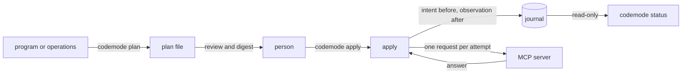

# How codemode works

codemode turns many writes into one plan file. A person reads the plan and
approves it once. codemode then sends those writes through one MCP server.
The [guide](mcp.md) describes the commands, the files, and every option. This
page says what the tool guarantees, how the code keeps each guarantee, and
where the guarantees end.

## What codemode promises

- **Nothing is sent before an approval.** `plan` and `status` send no write.
  `apply` is the only command that does. On its first run it starts no server
  process and makes no request until the plan is approved, and it records the
  approval in its journal before the first write.
- **The writes sent are the writes approved.** An approval names one digest
  of the plan file. `apply` stores the approved writes in its journal and
  sends from that copy. It refuses a plan file whose digest no longer matches.
- **The server is the one the plan was made for.** The plan records a digest
  of the server file, and `apply` uses only a server file with that digest.
  Before any write, `apply` also compares the connected server with the plan.
  A different identity, a missing tool, or a changed tool class or definition
  ends the run.
- **A failing server receives one write.** Each run sends its first write
  alone. By default it stops after the first write that does not end applied.
- **A write is sent again only when that is known to be safe.** Either its
  tool is a repeatable write, or the earlier attempt is known not to be
  applied. Every other uncertain write waits for a person. No write is sent
  more often than the approved number of attempts.
- **Every attempt is recorded before it is sent.** A killed `apply` leaves a
  journal that says which writes may have reached the server.

codemode does not promise:

- **Exactly-once delivery.** A repeatable write can reach the server more
  than once. Whether that is harmless depends on the server's
  `idempotentHint`, which codemode cannot check.
- **Rollback.** A run that stops leaves the applied writes applied.
- **That an applied write had its effect.** `applied` means the server
  answered with a result. codemode never reads the target back. A failure
  that a server reports inside a normal result is recorded as applied.
- **Authentication.** The name of an approver or a reviewer is recorded as
  given. An approval does not show who gave it.
- **Operating system isolation for a program.** The worker behind
  `plan --program` is a restricted V8 process, not a kernel sandbox.

## The plan file and its one digest

`plan` lists the server's tools, checks every proposed write against them,
and writes one JSON file. The [guide](mcp.md#the-plan-file) shows the format.
The layout is fixed, so the same change list for the same server gives the
same bytes, and a second person can review the file as a diff.

The digest is the SHA-256 of the file's canonical JSON (keys sorted, no white
space) without the field `server.file`. It covers:

- every write (identity, tool, arguments) and the order of the writes
- the summary
- the server identity, the protocol revision, and `trust_annotations`
- `server.config`, the SHA-256 of the server file's bytes as `plan` read them
- for each tool the writes use, its class, its definition digest, and whether
  the server marks it destructive or sent any annotation

A definition digest is the SHA-256 of the tool's name, argument schema, and
annotations. The plan digest leaves out:

- `server.file`, the path of the server file, so that both files may move
- layout, white space, and key order
- a tool's description and output schema, and every tool the plan does not use
- the values of the environment variables that the server file names
- the options of `apply`

Through `server.config` an approval binds the server file itself: its URL or
command, its `env` and header entries, its trust settings, and its
`write_tools` list. `apply` reads the server file once, from the recorded
path or from `--server <file>`, and refuses a file with another digest before
it prints the review. A plan file whose `server.file` was edited to point at
another server file is therefore refused, and so is a plan made by hand for a
server file that the operator did not write, when the operator passes their
own file with `--server`. The approval also binds two options of `apply`, as
the next section says. `plan` refuses a number whose
magnitude exceeds `2^53-1`, because a JSON reader such as JavaScript rounds
it, and the server could then act on a value nobody approved.

The plan never holds a credential. The server file names environment
variables as `${NAME}`, and each command reads their values into memory when
it starts. The plan records the server identity and the path of the server
file. The identity has no header or `env` value, and it shows a URL's query
string only as a digest. `plan` also refuses an argument key that names a
credential, such as `token`, `password`, or `api_key`, at any depth. That
check looks at keys only. Argument values are stored and shown as given.

## Approval

`apply` takes the approval in one of two ways.

- **A terminal question.** When stdin, stdout, and stderr are all terminals
  and `--json` is absent, `apply` prints the review and asks. Only the exact
  answer `yes` approves. All three must be terminals, so that the review is
  on the screen when the person answers.
- **`--approve <digest>`.** The value must be the plan's full digest. A wrong
  or shortened digest ends the command with exit code 4.

`apply` connects only after the approval. A stdio server is a command, and it
is not started for a plan that nobody approved. If the connection or the
comparison with the plan then fails, `apply` exits with 2, creates no
journal, and says that the plan was approved but nothing was recorded or
sent.

Without a terminal and without `--approve`, `apply` asks nobody and exits
with 4. An approval binds the plan digest and two options of the first run,
`--concurrency` (default 4) and `--max-attempts` (default 3). A later run
refuses both options. `--deadline-ms` and `--max-failures` are not bound.
They decide when a run stops, and they cannot add a write or an attempt.

The journal records the approver's stated name, the time, the plan digest,
the two numbers, the server identity, and for each tool whether it is
repeatable and its definition digest. A later run compares the file's digest
with the recorded one. Every run compares the connected server with the plan.
The executor (`src/executor.rs`) then builds a second digest from the
journal's copy of the writes, the connected server, and the approved numbers.
If it differs from the one stored with the approval, the run ends before any
write and the journal records the refusal.

The flag is not a security boundary. The refusal message prints the full
digest, and `status --json` prints it too. A process that can run
`codemode apply --approve` and can read the credentials the server file names
can approve its own plan. The terminal rule only keeps an approval from
happening by accident in a script. Separation comes from where the credential
lives. For example, the plan file is reviewed in a pull request, and `apply`
runs in CI, the only place that holds the credential. The process that
proposed the plan then has nothing to reach the server with.

## Sending writes

**The journal.** `apply` keeps a SQLite file next to the plan file. It holds a
copy of the approved writes, the approval, and facts that are only ever
added. Each fact has a number from one counter. For every attempt the order
is fixed:

1. The intent is committed. If that fails, nothing is sent and the run stops.
2. One request goes to the server.
3. The observation (a result or an error) is committed before the run counts
   the write as finished. If that fails, the run stops.
4. When a run ends while attempts still wait, each is recorded as unanswered.

An attempt with an intent and no observation is a write with no reply. That
is what a killed `apply` leaves behind. Records that arrive while a commit is
in flight share the next transaction, and each attempt continues only after
the commit that holds its own record. Unit tests in `src/executor.rs` hold
and fail these commits, and `tests/apply.rs` kills `apply` with SIGKILL while
the server holds a call. The journal uses SQLite's write-ahead log with
`synchronous=FULL`, so a commit returns after SQLite has asked the operating
system to flush it.

**The first write alone.** Each run sends the first write it has to send, in
plan order, and waits for its answer. A server that fails every write
receives one. After that answer, at most the approved number of writes are in
flight. A plan has no dependencies between writes and no control flow.

**The failure limit.** A run stops sending once `--max-failures` writes
(default 1) have ended without being applied. Writes already out finish and
are recorded, so up to the approved concurrency can end uncertain. Writes not
yet sent stay `not sent` for a later `apply`.

**The deadline.** `--deadline-ms` (default 300000) starts after the
connection is set up and covers the rest of the run. A write whose request is
out at the deadline is recorded with no reply. A write whose intent is
committed but whose request is not yet out is withdrawn and stays `not sent`.
Ctrl-C, and SIGTERM on Unix, cancel a run with the same effect on its writes.

**Rate limits.** An HTTP 429 means the server refused the request before it
ran the tool. The run sends nothing during the wait, then one write alone,
then the rest. The [guide](mcp.md#rate-limits) gives the waits.

**One executor.** `apply` and `resolve` take an operating system lock on
`<journal>.lock` before they open the journal, and hold it while they run. A
second `apply` or `resolve` exits with 2 and changes nothing.

**Reading during a run.** `status` opens the journal read-only and never
touches the lock file. It reads one snapshot of committed facts, writes no
journal data, and uses no network. It also reads the server file, to say
whether it still is the one the plan was made with. A run without a recorded end is either
running or killed. The journal cannot tell which, and `status` says so.

## What happens to each answer

The guide lists [every answer and its code](mcp.md#what-happens-to-each-answer).
This table gives the rule behind that list.

| Outcome of an attempt | Recorded as | What codemode does next |
| --- | --- | --- |
| The server answers with a result | applied | Nothing. The write is never sent again. |
| A tool error, or another error that does not say whether the tool ran | failed | A repeatable write is sent again by a later `apply`, while attempts are left. Any other write waits for `resolve`. |
| No reply, repeatable write | no reply | A later `apply` sends it again, while attempts are left. After that it waits for `resolve`. |
| No reply, any other write | no reply | It is not sent again. It waits for `resolve`. |
| HTTP 429 | not sent | The same run waits and sends it again as a new attempt. When every attempt is used, the write is refused and needs a new plan. |
| The request is rejected before the tool runs, by the server or by codemode | refused | It is not sent again. After a person fixes the cause and records `--as not-applied`, `apply` sends it while attempts are left. |
| The connection cannot be made | not sent | A later `apply` sends it, while attempts are left. |

Every outcome except the first counts toward `--max-failures`. A 429 counts
only when no further attempt follows it in the same run.

`resolve` adds a person's finding to the journal as one more fact. `applied`
ends the write. `not-applied` lets `apply` send it again within the approved
attempts. An answer settles only its own attempt. A repeatable write whose
first attempt got no reply and whose second was refused is still uncertain.

## The program worker

`plan --program` runs TypeScript to compute the change list. Each run starts
a fresh worker process from the `codemode` executable, with an empty
environment. The worker holds one V8 isolate. It refuses every import and has
no file system, network, environment, process, or FFI operation.
`WebAssembly`, `SharedArrayBuffer`, and `Atomics` are removed. The worker
exits when its parent's end of stdin closes, also during a JavaScript loop.

The parent process treats the worker's output as untrusted. Rust checks each
tool call against the list of read tools before the server sees it, and the
MCP client refuses any tool that is not a read. Rust also enforces the
deadline (which includes worker startup), the number of calls, the calls in
flight, and the output budget. The [guide](mcp.md#the-program) gives the
defaults. The program text, with the `--input` value inside it, must fit in
one 64 KiB frame. A call is at most 64 KiB and a reply at most 1 MiB. A
program that passes a limit ends with a status, and `plan` writes no file.
`--trace <file>` saves the program's execution record as JSON.

`--heap-mb` (default 256, minimum 16) bounds the V8 heap on every platform.
Reaching it ends the run with `memory_limit`. The heap budget does not cover
`ArrayBuffer` backing stores or native allocations. On Linux the worker sets
`RLIMIT_DATA` to the heap budget plus 256 MiB on itself before V8 starts,
which bounds those too. On every other platform, macOS included, no process
limit is applied and `ArrayBuffer` memory is unbounded. The worker is an
ordinary child process with the user's privileges. It is restricted by what
the isolate lacks, not by the operating system.

## Internals that are kept but not exposed

The executor is written against a trait, `RecoverableProvider`, and the MCP
client is one implementation of it. A provider declares a `RecoveryContract`
for each tool. It says whether a repeat is safe and how an uncertain attempt
can be reconciled (`receipt`, `state`, or `none`). For `receipt` and `state`,
a run first sends a reconciliation probe for each uncertain write, journaled
before the provider is asked and counted against a budget. `src/recovery.rs`
holds the model, and `tests/recovery.rs` runs it against an in-test provider.

The MCP provider declares `none` for every tool, because MCP gives a client
no way to ask whether an earlier call took effect. No probe is sent through
the CLI, and no option reaches this code. A verification read, which would
confirm a write by reading its target, would attach here as an implementation
of `reconcile` for a server that can name such a read. It is not built.

## Limits and untested ground

- **Power loss.** The tests kill processes. Whether a commit survives power
  loss depends on the storage device honoring flushes, and no test covers it.
- **The journal holds clear text.** It keeps the approved arguments for its
  whole life, with the stated names and the server's error text. The
  [guide](mcp.md#the-error-text) says what is removed from that text.
- **The journal is the only memory.** It is always next to the plan file, and
  no option moves it. Without it, `apply` treats the plan as new and, once
  approved, sends every write again. That includes a plan file copied to
  another directory. Its files are `<journal>`,
  `<journal>-wal`, `<journal>-shm`, and `<journal>.lock`. Keep them together,
  and move or delete them only when no command runs. Deleting or replacing
  the lock file while `apply` runs lets a second executor in.
- **Formats are unreleased.** A plan file (version 1) or a journal (format
  version 2) of another version is refused. There is no migration.
- **Platforms and live servers.** CI runs the tests on Linux only, against an
  offline stand-in server. The [guide](mcp.md) says what was checked live.
