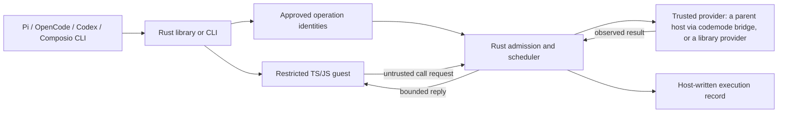

# A small Rust execution core

The design should fit a **30-minute technical explanation and demonstration**.
Its concepts are run-level control, rolling scheduling, execution evidence, and
bounded recovery of an approved batch of operations. A chosen guest backend and
provider adapter attach to that core.

## Run-level control

One host-owned deadline, call allowance, concurrency cap, cancellation signal,
and serialized-output allowance govern the run. Guest code cannot enlarge them.
Provider calls receive the shared deadline and cancellation context.

A host may start a guest before it knows the program (`PreparedGuest`, or a
bridge started ahead of time), so Deno and worker startup leave the run's
critical path. Each started guest serves exactly one run and is killed with it;
nothing is reused between runs. The deadline then starts when the program is
handed over, and the report's `prewarmed_ms` says how long the guest had waited.
Without prewarming, the deadline includes guest startup.

Programs select external Deno or an optional `deno_core` embedding. Both remain
child processes: the Rust controller can terminate them independently of guest
progress. The embedded worker owns one fresh V8 isolate and an in-memory
TypeScript transpiler, with no filesystem or network module loader. A native
stdin reader exits the worker on parent input closure even during a JavaScript
CPU loop. The embedding lives behind a default-off feature so the default build
retains Rust 1.85 support. See [its evaluation](embedded-evaluation.md).

A stop request cannot reverse an external side effect. Guest termination also
does not automatically make a still-observable provider result unknown. Collect
already-dispatched results while the run budget allows; prevent queued work from
starting after the guest finishes. A provider future that loses observation is
recorded as unknown. A guest program's run offers no recovery after the Rust host
itself crashes; an approved operation plan does (see below).

### Large tool results

Each reply to the guest may be up to 1 MiB, the size the guest launcher already
accepted; source and call frames from the guest stay at 64 KiB, and the shared
output budget still bounds the total. Until this change every reply was capped
at 64 KiB, so a workflow could not filter a large listing inside the guest at
all: in the shared benchmark, two 148 KiB issue pages stopped `triage-large` with
`output_limit` on every run, while Pi and OpenCode completed it. A host-side
projection or a result-reference mechanism was considered and not built. After
the frame-copy fix, `triage-large` took about 6 ms longer than `triage` at zero
latency for 250 KiB more results, including the larger trace; the budget keeps
memory and trace growth bounded; and either
mechanism would add helper surface and evidence semantics that no measured
workflow needed. Results above 1 MiB, or budgets the host will not raise, still
need smaller pages or a host-side filter in the adapter.

## Rolling scheduling

The guest program expresses dependencies with ordinary awaits and independent
work with promises. Rust starts a queued call when an active slot becomes free.
There is no separate dependency-graph planner.

Rolling dispatch is the only policy; the report records the limits it ran under.
A fixed-batch baseline, which started up to the cap only when no call was active
and waited for the whole batch as chunked parallel execution does, has been
removed. While it existed, [the evaluation](evaluation.md) compared both on the
same workload and concurrency cap: mixed-latency calls exposed idle slots at a
batch barrier, while equal-duration calls, provider rate limits, startup cost, or
very small workflows can remove the advantage. That is an algorithmic result,
not an inherent Rust speed claim.

## Execution evidence

A versioned JSON record (schema version 3) identifies the backend and contains
source for program runs, host-assigned call
identities, arguments, observed results or errors, event ordering, timing, final
output, and run status. Queued, dispatched, completed, rejected, and unknown work
remain separate. The CLI can keep the full record in a file while returning
compact status and output to its caller.

Rust timestamps come from one clock: its monotonic clock, in whole
milliseconds since run start. Each call records when it was admitted, dispatched,
finished, and, for program runs, when its reply was completely written to the guest's input, so
queue waiting, provider time, and delivery are separate. Run-level events mark the
guest's spawn and finish for program runs (with output, an error, or by exiting), a deadline or
cancellation observed by Rust, and guest termination. An `unknown` or
`cancelled_before_dispatch` event names the run status that caused it. Byte
counts cover arguments, observed values, reply frames, bytes exchanged with the
guest and with a bridge host, and observed values omitted as too large.

Provider-reported facts are separate from these observations: a provider such
as a bridge host may say it received a call, waited for permission, decided, or
entered its executor. Rust stamps each fact with its arrival time and keeps the
provider's own timestamp apart. A missing fact never proves a call did not run.

`codemode inspect <trace.json>` and `codemode::inspect` answer three questions
from a record, within a call limit and with counted omissions:

- **Why was this slow?** Exclusive phases that sum to the elapsed time: startup,
  guest-only time, tools running, waiting at the concurrency cap, waiting while a
  slot was free (dispatch latency), draining after the guest finished, and
  shutdown. Guest-only time is not split further: the record cannot tell guest
  computation from the gap between dependent steps, and inspection does not infer
  dependencies from call order.
- **Which calls ran?** Each call's evidence: result observed, provider error
  (after executor entry, after a permission denial, or unspecified), rejected or
  never dispatched, or unknown after executor entry, after receipt only, or
  without acknowledgment.
- **Which outcomes require reconciliation?** The unknown calls, with the status
  that ended them and the last provider fact, to check with the provider before
  any retry.

Inspection prints tool names, error codes, top-level argument keys, and sizes. It
leaves out argument values, results, and messages unless `--messages` is given,
and replaces control characters.

The JSON `output` field is present only when a guest value was observed within
limits, including an explicit JSON `null`. A provider task panic has its own run
status and call event; any unobserved external effect remains unknown.

Traces can contain private code or task data. An offline reproducer needs
explicit reviewed fixture values; ordinary summaries do not reconstruct omitted
data. Replay of live effects or programs, opaque result handles, billing,
provider catalogs, a UI, and persistent notebook state are deferred.

## Bounded recovery of approved operation lists

[Recoverable agent actions](recovery.md) adds durable accounting for one shape
of work: a finite, digested plan of independent operations that a person
approved. A SQLite journal records each operation's intent before the provider
can see it and its observation before anyone is told; after a crash, the trusted
provider's declared contract decides whether an uncertain operation is
reconciled by receipt, by state, repeated, or handed to a person. Dispatch
uses `run_calls` to submit operation identities directly to the same admission,
rolling scheduler, deadline, cancellation, and result-accounting loop. Native
input exhaustion drains queued work; a guest returning still prevents its
queued calls from starting. Native reports have backend `native`, empty source,
no final guest output, and no invented guest IDs, lifecycle events, transport
bytes, or delivery times. Records of earlier report schemas are not read. This
is not a workflow engine:
no dependencies, no control flow, and no
replay of the agent's program.

## Presentation shape

- **5 minutes:** the problem, one composed task, and the host/guest/provider boundary.
- **10 minutes:** Rust ownership of admission, bounded scheduling, and cancellation.
- **10 minutes:** run the task, expose a controlled failure, and inspect its trace;
  then approve a batch, kill the executor, and resume it (`mise run recovery-demo`).
- **5 minutes:** measured tradeoffs, limits of the evidence, and host-adapter scope.

Use public synthetic fixtures for the demonstration. A live provider can later
establish integration separately. Keep private backend code, data, event names,
and presentation logistics out of public examples.
