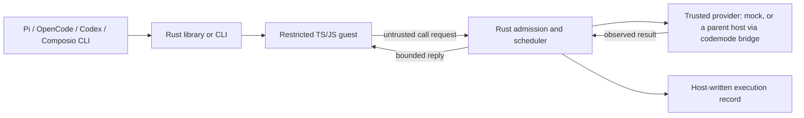

# A small Rust execution core

The design should fit a **30-minute technical explanation and demonstration**.
Its three concepts are run-level control, rolling scheduling, and execution
evidence. A chosen guest backend and provider adapter attach to that core.

## Run-level control

One host-owned deadline, call allowance, concurrency cap, cancellation signal,
and serialized-output allowance govern the run. Guest code cannot enlarge them.
Provider calls receive the shared deadline and cancellation context.

A stop request cannot reverse an external side effect. Guest termination also
does not automatically make a still-observable provider result unknown. Collect
already-dispatched results while the run budget allows; prevent queued work from
starting after the guest finishes. A provider future that loses observation is
recorded as unknown. This prototype offers no recovery guarantee after the Rust
host itself crashes.

## Rolling scheduling

The guest program expresses dependencies with ordinary awaits and independent
work with promises. Rust starts a queued call when an active slot becomes free.
There is no separate dependency-graph planner.

`RunConfig::dispatch` (`--dispatch rolling|batch`) selects the policy; rolling
is the default. The batch policy is a baseline: it starts up to the cap only when
no call is active and waits for the whole batch, as chunked parallel execution
does. Calls the guest submits in one synchronous turn reach Rust in one write, so
they share a batch. A sequential baseline is either policy with a cap of 1. The
report records the policy and limits it ran under.

Compare the same workload and concurrency cap under batch and rolling policies
before claiming an improvement. Mixed-latency calls can expose idle slots at a
batch barrier. Equal-duration calls, provider rate limits, startup cost, or very
small workflows can remove the advantage. That is an algorithmic hypothesis,
not an inherent Rust speed claim; [the evaluation](evaluation.md) measures it.

## Execution evidence

A versioned JSON record contains source, host-assigned call identities,
arguments, observed results or errors, event ordering, timing, final output, and
run status. Queued, dispatched, completed, rejected, and unknown work remain
separate. The CLI can keep the full record in a file while returning compact
status and output to its caller.

The JSON `output` field is present only when a guest value was observed within
limits, including an explicit JSON `null`. A provider task panic has its own run
status and call event; any unobserved external effect remains unknown.

Traces can contain private code or task data. An offline reproducer needs
explicit reviewed fixture values; ordinary summaries do not reconstruct omitted
data. Replay of live effects, opaque result handles, durable journals, billing,
provider catalogs, a UI, and persistent notebook state are deferred.

## Presentation shape

- **5 minutes:** the problem, one composed task, and the host/guest/provider boundary.
- **10 minutes:** Rust ownership of admission, bounded scheduling, and cancellation.
- **10 minutes:** run the task, expose a controlled failure, and inspect its trace.
- **5 minutes:** measured tradeoffs, limits of the evidence, and host-adapter scope.

Use public synthetic fixtures for the demonstration. A live provider can later
establish integration separately. Keep private backend code, data, event names,
and presentation logistics out of public examples.
