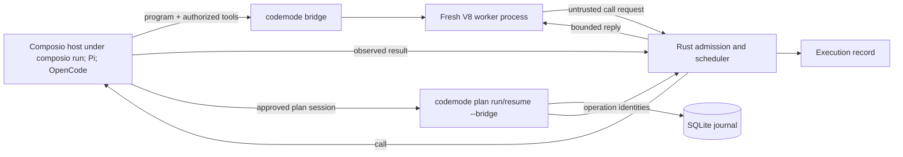

# A small Rust execution core

The design should fit a **30-minute technical explanation and demonstration**
built around one workflow: GitHub issue triage through the Composio CLI. Its
concepts are host-owned run limits, rolling scheduling, execution evidence, and
bounded recovery of an approved batch of operations.

## Run-level control

One host-owned deadline, call allowance, concurrency cap, cancellation signal,
output allowance, and memory budget govern a program's run. Guest code cannot
enlarge them. Provider calls receive the shared deadline and cancellation
context.

Each program runs in a fresh worker process started from the `codemode`
executable. The worker owns one V8 isolate (through the `deno_core` crate) and
an in-memory TypeScript transpiler. It gets an empty environment, refuses every
import, and installs no filesystem, network, environment, process, or FFI
operations; `WebAssembly`, `SharedArrayBuffer`, and `Atomics` are removed. A
native stdin reader exits the worker when its parent's input closes, even during
a JavaScript CPU loop. Nothing is reused between runs. The bridge starts the
worker after the host's start frame, and the run's deadline, which includes
worker startup, starts with that frame.

**Memory.** The V8 heap budget (`--heap-mb`, default 256, minimum 16) is
enforced on every platform. Reaching it stops the worker and ends the run with
`memory_limit`. The heap budget is not a process-memory limit: `ArrayBuffer`
backing stores and native allocations are outside it. On Linux the worker
applies a data-segment limit (`RLIMIT_DATA`, default heap budget + 256 MiB,
`--process-memory-mb`) to itself before starting V8, which bounds those too; an
allocation that fails under it also ends the run with `memory_limit`. Other
platforms apply no process limit and refuse `--process-memory-mb` before a
worker starts. A worker that dies for another reason ends the run with
`worker_crashed`, with its exit code or signal in the report. No sampled RSS
watchdog exists: it could not be a hard ceiling.

A stop request cannot reverse an external side effect. Worker termination also
does not make a still-observable provider result unknown: already-dispatched
results are collected while the run budget allows, and queued work does not
start after the guest finishes. A call whose result is never observed is
unknown, including when memory exhaustion or a crash ends the run with it in
flight. A program's run offers no recovery after the Rust host itself crashes;
an approved plan does (see below).

### Large tool results

Each reply to the guest may be up to 1 MiB; source and call frames from the
guest stay at 64 KiB, and the shared output budget bounds the total. These are
output and transport limits, not memory limits. A host-side projection or a
result-reference mechanism was considered and not built: no measured workflow
needed the extra helper surface. Results above 1 MiB need smaller pages or a
host-side filter in the adapter; the Composio host, for example, replaces
signed download URLs before the program sees a result.

## Rolling scheduling

The guest program expresses dependencies with ordinary awaits and independent
work with promises. Rust starts a queued call when an active slot becomes free.
There is no dependency-graph planner, and rolling dispatch is the only policy.
The report records the limits each run executed under.

## Execution evidence

A versioned JSON record (report schema 5) identifies the execution source
(`embedded_v8` for programs, `native` for plan dispatch) and contains the source
of a program run, host-assigned call identities, arguments, observed results or
errors, event ordering, timing, final output, the limits including heap and
process data limits, the run status, and how the worker exited when it died.
Queued, dispatched, completed, rejected, and unknown work remain separate.
Records of earlier schemas are not read.

Rust timestamps come from its monotonic clock, in whole milliseconds since run
start. Each call records when it was admitted, dispatched, finished, and, for
program runs, when its reply reached the worker, so queue waiting, provider
time, and delivery are separate. Byte counts cover arguments, observed values,
reply frames, and bytes exchanged with the worker and with a bridge host.

Provider-reported facts are separate from these observations: a bridge host may
say it received a call, waited for permission, decided, or entered its
executor. Rust stamps each fact with its arrival time and keeps the host's own
timestamp apart. A missing fact never proves a call did not run.

`codemode inspect <trace.json>` and `codemode::inspect` answer three questions
from a record, within a call limit and with counted omissions:

- **Why was this slow?** Exclusive phases that sum to the elapsed time: startup,
  guest-only time, tools running, waiting at the concurrency cap, waiting while a
  slot was free, draining after the guest finished, and shutdown.
- **Which calls ran?** Each call's evidence: result observed, provider error,
  rejected or never dispatched, or unknown, with how far the host reported it got.
- **Which outcomes require reconciliation?** The unknown calls, with the status
  that ended them and the last provider fact.

Inspection prints tool names, error codes, top-level argument keys, and sizes. It
leaves out argument values, results, and messages unless `--messages` is given.
Traces can still contain private code or task data; the Composio host's
investigation trace keeps result sizes, not values.

## Bounded recovery of approved operation lists

[Recoverable agent actions](recovery.md) adds durable accounting for one shape
of work: a finite, digested plan of independent operations that a person
approved. `plan check` shows every operation's canonical arguments, scope,
contracts, retention, budgets, and the digest that approval binds; plans refuse
integers outside ±(2^53−1), so the approved value is the one a JavaScript host
sends.

A SQLite journal records each attempt's intent before the provider can see it
and its observation before anyone is told. Intents, observations, and probe
records that arrive while another commit is in flight share the next
transaction (group commit); each attempt continues only after the commit that
holds its own record, so the ordering is unchanged. One session deadline
(`--deadline-ms`) covers authorization, reconciliation probes, host permission
waits, and dispatch.

One executor holds a journal at a time, through an operating-system lock on
`<journal>.lock`. `plan inspect` and `plan trace` open the journal read-only,
never touch the lock, write no journal data, and work while a session runs; an
open session means "no end recorded", not proof that an executor is alive.

After a crash, the provider's declared contract decides whether an uncertain
operation is reconciled by receipt, by state, repeated, or handed to a person.
Dispatch submits operation identities to the same admission, rolling
scheduler, deadline, cancellation, and accounting loop as programs, with no
worker process. This is not a workflow engine: no dependencies, no control flow,
and no replay of the agent's program.

## Presentation shape

- **5 minutes:** the problem (an agent changes several issues, then something
  is interrupted) and the host, worker, and provider boundary.
- **10 minutes:** investigate a repository with read-only tools, show the
  execution record, and review the proposed plan with `plan check`: exact
  arguments, scope, contracts, and digest.
- **10 minutes:** approve, run, inspect from a second terminal, interrupt,
  resume, and export the diagnosis, following the [guide](composio-github.md)
  against a test repository. Offline, `mise run composio-demo` covers
  investigation through inspection, and `mise run recovery-demo` kills an
  executor mid-batch and resumes it.
- **5 minutes:** limits (memory, no exactly-once, offline versus live
  evidence) and the [comparison](comparison.md).

Use the offline stand-in or a test repository you own. Keep private backend
code, data, event names, and presentation logistics out of public examples.
