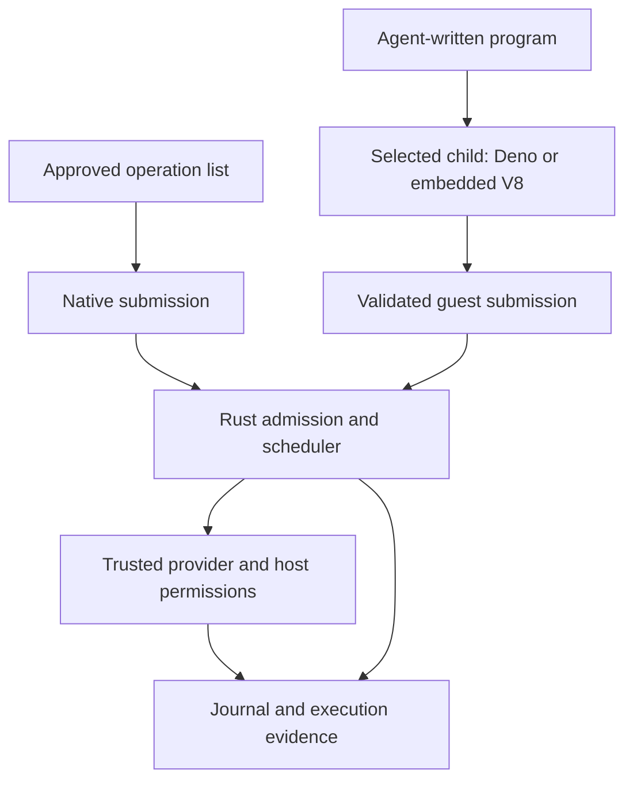
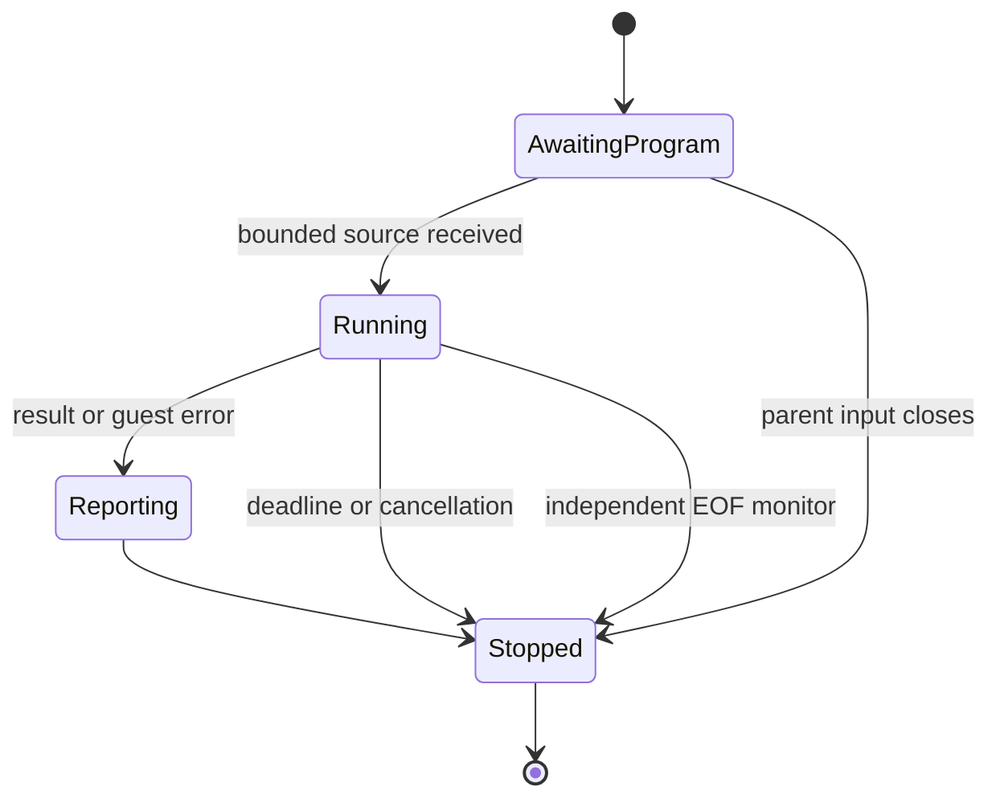

# Native Plans and Embedded Guest - Plan

## Goal Capsule

**Objective:** Developers can run approved batches with less local overhead and evaluate a self-contained JavaScript execution option without changing their tool providers.
**Means:** Native approved-operation submission followed by an opt-in embedded engine in a separate worker process (KTD1, KTD2).
**Authority:** This request and repository instructions govern; R-IDs own product behavior and KTDs own implementation choices.
**Execution profile:** Two phases, six independently verified local units; implementation and local commits are authorized on the existing main branch. Publication and further external mutations are excluded.
**Stop conditions:** Preserve Rust 1.85 for the default build, existing approval/journal guarantees, and honest trace evidence. A dependency or engine failure must not silently substitute another backend or weaken those constraints.

---

## Product Contract

### Summary

Approved operation lists submit directly to Rust's existing scheduler, so plan execution no longer installs or launches Deno.
Arbitrary programs gain an explicitly selected embedded V8 worker while the existing Deno backend remains the default for comparison.

### Problem Frame

The recovery product is now demonstrated against a real provider, but its fixed approved operation list still launches JavaScript solely to submit work back to Rust.
Existing measurements attribute 24–42 ms per dispatch run to guest startup.
Users also install a separate Deno executable even though the CLI and scheduling core are already Rust.
The subprocess currently gives the controller independent termination and failure containment, so removing it changes a useful contract.

### Requirements

#### Approved plans

- R1. Library, CLI, Pi, and Composio plan execution must work without finding or starting Deno.
- R2. Native and program execution share admission, bounded dispatch, cancellation, deadlines, result accounting, and provider-fact handling; there is no second independent scheduler.
- R3. Approval, account/destination scope, retention, attempt/probe budgets, journal ordering, and conservative recovery conclusions retain their current semantics.
- R4. Native input exhaustion drains admitted work; cancellation and failure still distinguish queued work from genuinely unknown running outcomes.

#### Arbitrary programs

- R5. An opt-in embedded backend evaluates JavaScript and TypeScript in a fresh child process without an external Deno executable.
- R6. Provider execution, credentials, journal, and control remain outside the guest; guest filesystem, network, environment, process, FFI, and unapproved imports remain unavailable.
- R7. Both program backends preserve the tools.call helper, promises, catchable provider errors, explicit final output, unawaited-call handling, and same-turn submission behavior.
- R8. The parent enforces termination independently of guest progress; parent death must stop an embedded worker even while JavaScript spins.

#### Evidence and compatibility

- R9. Reports identify native, Deno, and embedded execution truthfully; native reports invent no source execution, guest lifecycle, transport bytes, or reply delivery.
- R10. Historical reports remain inspectable, and existing plan scripts accepting --deno continue to work with that option unused in native plan mode.
- R11. The default dependency/build path retains Rust 1.85; the opt-in embedded feature documents and verifies its separate compiler requirement.
- R12. Matched recovery baselines use the same native submission path, while program-engine comparisons match workloads, limits, and correctness oracles.
- R13. Keep historical results unchanged and publish measured regressions as well as gains before deciding whether to change a default.

### Key Decisions

- **Keep the engine isolated.** A separate worker contains engine failures and preserves independent termination. Governs R5, R6, R8. (session-settled: user-approved — chosen over direct embedding in the controller: retain the existing process boundary.)
- **Implement native plans first.** Their approved finite operation list needs no JavaScript execution. Governs R1–R4. (session-settled: user-approved — chosen over beginning with a general engine replacement: remove overhead from the proven recovery workflow first.)

### Acceptance Examples

- AE1. Covers R1, R3, R4: a fixture plan runs with a nonexistent Deno executable, is killed after an effect, and resumes according to its provider contract with no blind retry.
- AE2. Covers R6, R8: an embedded program spins indefinitely; the parent deadline ends it, and killing the parent separately leaves no worker behind.
- AE3. Covers R7, R9: the same composed program produces the same result on Deno and embedded backends, with independently observed tool calls and backend-specific truthful evidence.

### Scope Boundaries

No new recovery policies, account integrations, live external changes, permission bypass, pooling, arbitrary module/package loading, snapshots, new languages, or default-backend switch.
Direct in-process embedding and worker reuse are considered but excluded because they change fault containment or cross-run state; revisit only with a separate contract and measurements.

---

## Planning Contract

### Key Technical Decisions

- KTD1. **One scheduler, two submission sources.** Extract only the shared execution state and control needed to accept a finite native list as well as guest requests; preserve the journaling provider wrapper and its ordering hooks. Implements R1–R4.
- KTD2. **Same-executable embedded worker.** Reuse the restricted stdin/stdout guest protocol, with an explicit worker executable path for library consumers and CLI resolution to its own executable. Implements R5–R8 and the isolated-engine decision.
- KTD3. **Small embedding dependency surface.** Prototype published deno_core 0.413.0 plus deno_ast 0.53.3 with transpilation; use core's V8 re-export and aligned deno_error 0.7.1 only when op signatures need it. Do not add deno_runtime or an independent mismatched V8 package. Implements R5–R7, R11.
- KTD4. **Opt-in compiler boundary.** The embedded-v8 feature is excluded from the default graph; current deno_core contains let chains unavailable on Rust 1.85, so test the feature on the current compiler and default features on 1.85. Document the tested compiler without claiming an unverified minimum. Implements R11.
- KTD5. **Backend-aware evidence.** Make a deliberate report-format extension/version decision, preserving historical deserialization. Native timing accounts for scheduler/provider work without fictitious guest phases. Implements R9, R10.
- KTD6. **Independent worker liveness.** Native input monitoring runs independently of JavaScript, allowing EOF after parent death to terminate the process even during CPU-bound execution; parent process kill remains the hard deadline fallback. Implements R8.
- KTD7. **Conservative adoption.** Keep Deno as the program default and expose missing experimental support as an explicit error. Compare the embedded worker against Deno and existing prewarming rather than assume engine initialization disappears. Implements R12, R13.

### High-Level Technical Design

The native source's end means there are no more submissions, not that a guest has finished and cancelled queued calls.
Native success waits for the admitted queue and in-flight tasks to finish.
The embedded child owns one fresh isolate; the controller alone owns tool admission and external effects.

### Assumptions and Execution-Time Unknowns

The optional feature may require a compiler newer than the source-level 1.88 lower bound, because transitive dependencies have their own requirements.
Actual archive availability, build/link cost, supported helper globals, cold/prewarmed latency, and memory cost are execution-time findings.
No numeric improvement is promised for embedding; a backend default change requires a later decision based on conformance and measurements.
The native plan path should eliminate guest process startup; remeasure the same fixtures rather than subtract historical startup numbers from a new total.

### Research Basis

- src/executor.rs: dispatcher_program, dispatch_run, JournalingProvider, and queued journal-write accounting.
- src/runtime.rs: current process launch, admission/dispatch loop, provider facts, result budgets, and finalization.
- src/inspect.rs and tests/inspect.rs: exclusive timing phases and historical schema handling.
- integrations/shared/bridge-client.ts, integrations/pi/codemode-bridge.ts, and integrations/composio/plan-host.ts: plan paths currently resolve Deno.
- src/bin/codemode-recovery-eval.rs: baseline dispatcher must change with the measured plan path.
- [Deno core embedding APIs](https://github.com/denoland/deno/blob/main/libs/core/README.md), [published core manifest](https://docs.rs/crate/deno_core/0.413.0/source/Cargo.toml), and [TypeScript embedding example](https://github.com/denoland/deno/blob/main/libs/core/examples/ts_module_loader.rs).
- [V8 termination](https://docs.rs/v8/latest/v8/struct.IsolateHandle.html#method.terminate_execution) and [heap-limit behavior](https://docs.rs/v8/latest/v8/struct.CreateParams.html#method.heap_limits) inform KTD2/KTD6; a heap cap does not bound all process allocations.

---

## Implementation Units

### Phase 1: Native approved actions

### U1. Add native submission to the shared execution core

**Goal:** Offer a finite host-owned call list through the same controls as program execution.
**Requirements:** R2, R4, R9, R10; KTD1, KTD5.
**Dependencies:** None.
**Files:** src/runtime.rs, a focused internal scheduler module if needed, src/lib.rs, src/inspect.rs, tests/native.rs, tests/inspect.rs, tests/runtime.rs.
**Approach:** Separate guest transport/lifecycle from the existing control state; add native submission with explicit exhaustion and backend identity. Preserve guest timing and finalization semantics.
**Patterns:** Existing call validation, provider task accounting, bounded observations, and historical report fixtures.
**Test scenarios:** Empty and finite input; rolling refill/concurrency cap; authorization/allowance/argument limits; provider facts and errors/panics; output limits; deadline/cancellation with queued and in-flight calls; native timing totals and absence of guest evidence; old reports remain readable.
**Verification:** Native controls match program controls on their shared semantic contract; guest-specific protocol regression tests still pass.

### U2. Run plans and host adapters without Deno

**Goal:** Make the approved-action product independent of a JavaScript engine.
**Requirements:** R1, R3, R4, R10; AE1; KTD1.
**Dependencies:** U1.
**Files:** src/executor.rs, src/plan_cli.rs, integrations/shared/bridge-client.ts, integrations/pi/codemode-bridge.ts, integrations/composio/plan-host.ts, integrations/composio/run-plan-preflight.sh, tests/recovery.rs, tests/plan_cli.rs, tests/pi_plan.rs, tests/composio_plan.rs, tests/plan_bridge.rs.
**Approach:** Map approved operation IDs directly into native submission. Retain the journaling provider and accepted legacy Deno arguments; remove executable lookup from plan host paths.
**Test scenarios:** Plans run with an invalid Deno path; no guest process is created; real executor SIGKILL/resume preserves unknown outcomes and provider-ledger correctness; ordering/retention hooks remain effective; Pi/Composio offline plan flows retain host authorization.
**Verification:** Native plan CLI and host checks succeed without a usable inner Deno executable; ordinary program execution still uses its selected backend.

### U3. Align and measure native recovery baselines

**Goal:** Quantify the phase-1 effect without changing comparison semantics.
**Requirements:** R12, R13; KTD7.
**Dependencies:** U2.
**Files:** src/bin/codemode-recovery-eval.rs, tests/recovery_eval.rs, docs/recovery-evaluation.md, new eval result directory.
**Approach:** Move no-journal and blind-retry baseline dispatch to the same native submission path. Tag the backend and represent guest startup as absent/zero under a documented metric. Preserve old results.
**Test scenarios:** Independent fixture ledger still distinguishes repeated requests and duplicate effects; identical crashed states and matching caps; zero native guest transport; all comparison cells retain correctness checks.
**Verification:** Fingerprinted repeated measurements report latency and persistence overhead separately, and the comparison uses one execution path per matched cell.

### Phase 2: Embedded arbitrary-code worker

### U4. Build the optional embedded engine worker

**Goal:** Execute restricted JavaScript/TypeScript using a Rust embedding library in a fresh isolated child.
**Requirements:** R5–R8, R11; AE2; KTD2–KTD4, KTD6.
**Dependencies:** U1.
**Files:** Cargo.toml, Cargo.lock, src/embedded.rs, src/embedded_guest.js, src/lib.rs, tests/embedded.rs.
**Approach:** Add the opt-in dependency graph, minimal safe Rust ops and TypeScript transpilation, bounded protocol input, and independent EOF monitoring. Verify a real build early before expanding the implementation.
**Test scenarios:** JavaScript and typed source; async tool replies and catchable errors; forbidden capabilities/imports; CPU loop termination and parent-death cleanup; bounded replies; fresh state across runs; explicit unsupported-feature error.
**Verification:** The worker builds and runs on the recorded compiler while default-feature code still builds/tests on Rust 1.85; no hand-written unsafe Rust is introduced.

### U5. Expose and validate explicit backend selection

**Goal:** Let CLI and bridge callers select the embedded backend while retaining current defaults.
**Requirements:** R5–R10; AE2, AE3; KTD2, KTD5–KTD7.
**Dependencies:** U4, U2.
**Files:** src/runtime.rs, src/main.rs, src/bridge.rs, integrations/shared/bridge-client.ts, tests/embedded.rs, tests/cli.rs, tests/bridge.rs, tests/runtime.rs.
**Approach:** Route the selected executable through the existing child transport and parent controls; identify backend in evidence and allow prewarming to initialize the selected engine before source arrives.
**Test scenarios:** CLI/bridge selection; library consumer with an explicit worker path; default unchanged; feature-disabled selection fails clearly; shared program-result/limit/cancellation behavior; same-turn batching and prewarmed lifecycle.
**Verification:** Program workflows and limits agree across selected backends without recreating Deno-specific raw-stdio globals in the embedded guest.

### U6. Measure engine tradeoffs and finish documentation

**Goal:** Supply reproducible evidence for the backend choice and precise deployment instructions.
**Requirements:** R9, R11–R13; AE3; KTD7.
**Dependencies:** U3, U5.
**Files:** A focused benchmark harness under bench or src/bin, associated public-contract tests if needed, mise.toml, README.md, CONTRIBUTING.md, docs/design.md, docs/integrations.md, new docs/embedded-evaluation.md and result artifacts.
**Approach:** Compare matching no-op, composed-tool, and large-result workflows across Deno, prewarmed Deno, embedded, and prewarmed embedded. Record p50/p95, process-tree memory, binary sizes, compiler/features, and build costs. Document supported globals and remaining limits.
**Test scenarios:** Every timed result checked independently; matching concurrency and budgets; timeout/cancellation samples excluded from success-latency claims but retained as evidence; default and optional compiler paths documented accurately.
**Verification:** Conformance gates pass; measurements disclose wins, losses, and uncertainty; no default change is implied by the experiment.

---

## Verification Contract

Use the repository's check task, declared MSRV tests, and focused tests named by each unit.
Run default-feature tests on Rust 1.85 and the embedded feature on the current tested compiler; the all-features check must pass there.
Exercise native and embedded conformance, ordering/retention tests, real-process crash recovery, Pi/OpenCode host checks, Composio offline checks, and recovery demo; no live external writes are required.
Keep the existing Deno backend's adversarial protocol tests and generic-program orphan regression separate from native no-guest assertions.
If the existing concurrent Pi order assertion flakes, establish whether order is contractual before correcting only that assertion.
Complete the requested code-review workflow and two independent Codex reviews of changed scheduler, trace, isolation, and helper boundaries, with the latter after fixes.
Commit each verified implementation unit locally with explicit owned paths; do not publish the branch.

---

## Definition of Done

Native approved plans and verified host plan flows work without Deno, using shared controls and truthful traces.
The optional embedded worker runs real JavaScript/TypeScript under the preserved parent control contract, with tested cancellation and orphan cleanup.
Default Rust 1.85 compatibility, current-compiler all-feature checks, and relevant host/crash tests pass.
Matched baseline and engine measurements are reproducible, fingerprinted, and checked for correctness.
Documentation states actual feature/compiler/backend guarantees and measured limitations.
Required review findings are resolved, abandoned experimental code is removed, completed units are committed locally, and unrelated historical work is preserved.
