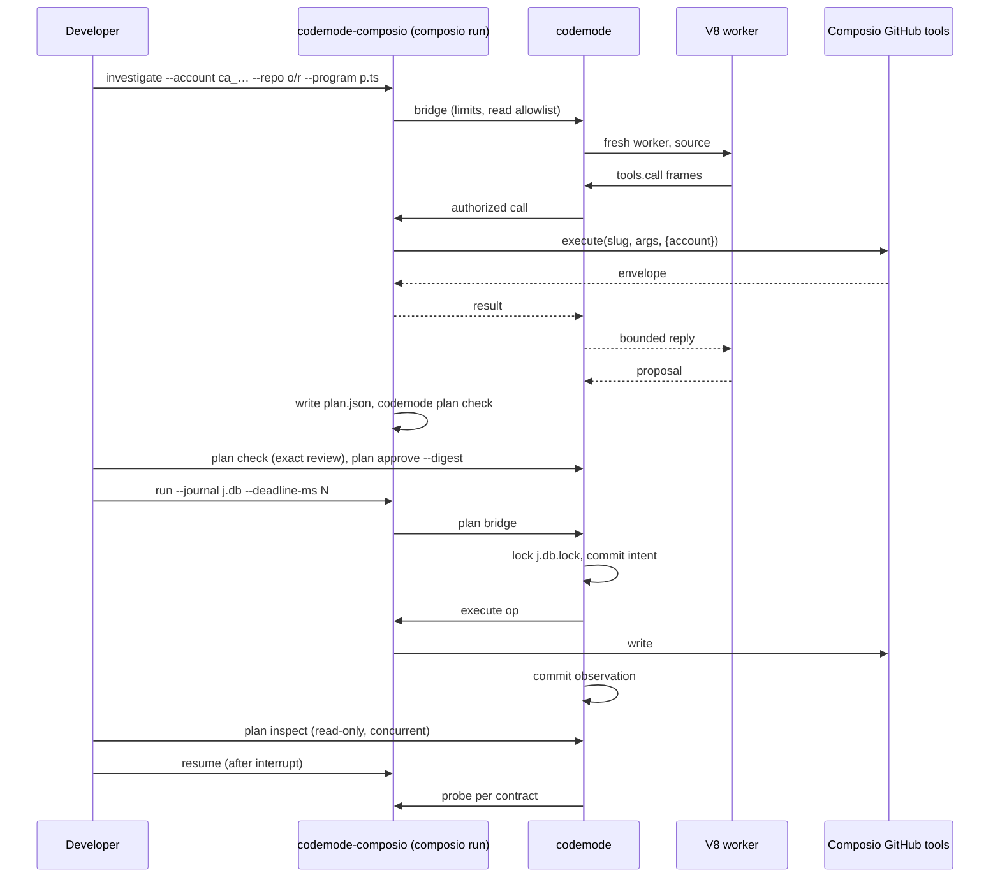
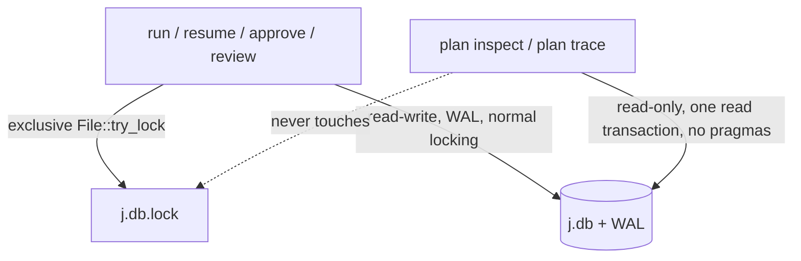
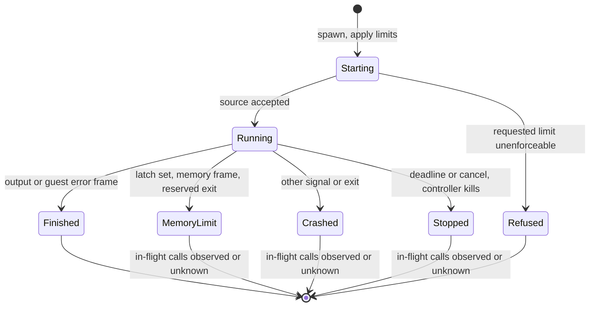
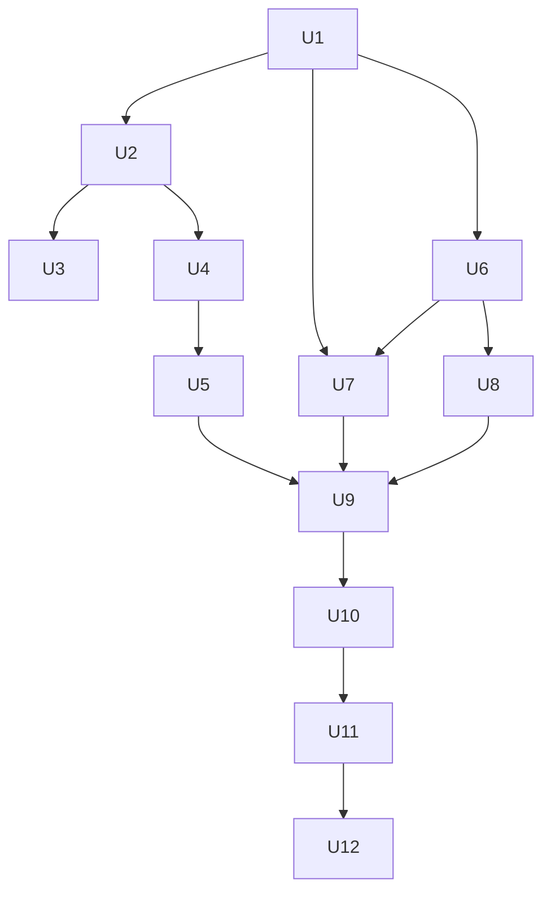

# Composio GitHub Workflow - Plan

## Goal Capsule

**Objective:** A Composio developer can go from an installed bundle to investigating a GitHub problem with authorized reads, reviewing and approving an exact change list, executing it under explicit limits, watching it progress, and recovering an interrupted batch without guessing what happened. Measured evidence shows where this beats, ties, or loses to current Pi Durable, OpenCode Code Mode, and a competent Composio CLI script.
**Means:** Subtract compatibility and evaluation surfaces first (KTD1, KTD2), consolidate on one embedded V8 worker with a real heap budget (KTD3, KTD4), add read-only live inspection and one session deadline (KTD5, KTD6), then build the Composio GitHub host and a fair comparison harness (KTD9–KTD12).
**Authority:** The 2026-11-09 request governs, then `AGENTS.md`, then this plan. R-IDs own product behavior; KTDs own mechanism.
**Execution profile:** Four phases (A–D), twelve units. Each green unit is committed on `main`; completed work is pushed to `main` after local checks and reviews, and CI is verified on the exact pushed head. No release is published.
**Stop conditions:** Stop and report rather than proceed when a change would weaken a trust property in R6–R12, when the declared compiler floor cannot be verified, when a live mutation lacks a fresh explicit authorization naming its target, or when private Composio source details would enter the repository.

---

## Product Contract

### Summary

codemode becomes a small Rust execution tool for one workflow: investigate a GitHub problem through the existing Composio CLI connection, produce a finite change list, review and approve it exactly, execute it under host-owned limits, inspect it live, and recover it conservatively after interruption.
Unreleased compatibility code, the external Deno backend, evaluation-only controls, and stale documentation are removed first.
The remaining engine gains an enforced V8 heap budget, the journal gains a read-only inspection path, and the comparison is rebuilt against current pinned alternatives.

### Problem Frame

codemode accumulated surfaces faster than it gained a user path.
It ships two program engines, a batch dispatch policy kept only to win a benchmark, an offline fixture inside the production binary, compatibility readers for formats that were never released, and a deprecation policy for an unreleased tool.
None of that helps the person the project now serves: a Composio developer who wants an agent to change several GitHub issues and needs to know, after a crash or a lost reply, what happened.

That person cannot complete the path today.
Investigation and planning use two hosts with different account binding, and nothing turns investigation output into a plan.
`plan inspect` takes SQLite's exclusive lock, so progress cannot be watched while a batch runs, and the only supported mutation is adding one existing label.
A program can exhaust memory without a classified outcome.
The plan parser silently rounds integers beyond 64 bits, so an approved plan can differ from the file the reviewer read.

The comparison evidence is also stale.
It pins OpenCode's legacy 1.x line and does not include Pi Durable, which now journals intent and observations and is the strongest durability competitor.
A competent Composio-native script baseline has never been built, so "better than a script" is unproven.

### Requirements

**Workflow**

- R1. From an installed bundle, one documented path runs authorized GitHub read tools through the logged-in Composio CLI on an explicitly pinned connected account, without a project SDK key.
- R2. The investigating program returns a proposal that the host writes as a separate plan file; the plan is what is reviewed and executed, and the program is never replayed.
- R3. Plan validation checks each operation against the declared provider contract and refuses tools, arguments, accounts, or destinations outside it.
- R4. Before approval, `plan check` shows the exact canonical operations, arguments, account, destinations, contracts, retention, budgets, and digest that approval will bind.
- R5. A bounded, redacted diagnosis of any journal can be exported as JSON (`plan inspect --json`).

**Trust properties (preserved, never weakened)**

- R6. Admission, authorization, deadlines, concurrency, and output bounds stay host-owned; guest code cannot enlarge them.
- R7. Credentials stay outside guest execution, and host permission gates still decide every call.
- R8. Approval binds the plan digest, provider, account, destinations, contracts, retention, and attempt, probe, and concurrency budgets; any change requires a new approval.
- R9. Intent is durable before provider entry, and an observation is durable before anyone is told of it.
- R10. A cancelled request, missing acknowledgement, killed worker, or killed executor never establishes non-effect, and a satisfied postcondition never establishes attribution.
- R11. Reconciliation follows only the provider's declared contract; anything it cannot settle goes to human review with its evidence.
- R12. Retention policy is applied before data reaches SQLite or its WAL, and recovery-required approved inputs are the only sensitive values the journal must keep.

**Execution engine and resources**

- R13. Programs run in one Rust-embedded V8 worker: a fresh process per run, supervised and killable by Rust independently of guest progress.
- R14. The guest keeps the `tools.call` helper, promises, catchable provider errors, explicit output, TypeScript type stripping, and restricted imports and capabilities.
- R15. A configurable V8 heap budget is enforced and its exhaustion ends the run with an explicit memory status.
- R16. Where the platform can enforce a process data limit it is applied and reported; a requested limit the platform cannot enforce is refused before the run starts.
- R17. Worker death, memory termination, or a crash with calls in flight leaves those calls observed if observed, otherwise unknown.

**Inspection and deadlines**

- R18. Journal inspection works while an executor is running, shows only committed evidence, writes no journal data, advances no checkpoint, and changes no durability setting; it may create SQLite's shared-memory index file.
- R19. Inspection distinguishes an open session from proof that an executor is alive.
- R20. At most one executor (run, resume, approve, or review) holds a journal at a time.
- R21. One total session deadline per invocation covers authorization, reconciliation, permission waits, and dispatch.
- R22. Persistence changes are justified by measurement and preserve every ordering guarantee and charged unanswered probe.

**Exact values**

- R23. Integers outside ±(2^53−1) are refused in plans; null and absent stay distinct; approved values reach the provider unchanged.

**Subtraction**

- R24. Every retained command, flag, export, feature, dependency, task, and CI job has a named consumer or operational requirement.
- R25. Unreleased compatibility paths, deprecation promises, aliases, and ignored options are deleted outright.
- R26. Fixtures, mock tools, fault injection, and evaluation controls are absent from the production binary, the library's default API, and the installed bundle.
- R27. Historical results, existing journals, credentials, and unrelated work are preserved; historical documents keep their provenance.

**Evidence**

- R28. The same workflow is compared against current pinned Pi Durable, current pinned OpenCode Code Mode, and a competent Composio-native script using the same provider contracts, with mismatches documented. The competent script reads current issue state before each write, keeps an fsynced progress file, resumes from it, checks for its own marked comment before re-posting, and is published with the results.
- R29. Each comparison is scored per property and per scenario against an independent provider ledger, and reports ties, losses, and unsupported cases.
- R30. Documentation, help, installation, and comparisons describe the same product and only verified behavior.

### Key Decisions

- **The workflow is GitHub issue triage.** Reads cover issues, labels, comments, workflow runs, jobs, logs, and check runs; writes are add labels, remove a label, set issue state, and create a marked comment. These four writes span state-reconcilable and non-repeatable operations, which is what the recovery story must show. Governs R1–R4.
- **Remove `codemode run` and its mock tools from the product.** It has no Composio role; the offline walkthrough uses the testing harness instead. Governs R24, R26.
- **Keep the Pi and OpenCode adapters at their integration pins.** The request requires real pinned-host checks, so they keep a consumer. They reach the same executor from those hosts; the comparison is against those projects' own code-mode engines. Docs present them as secondary hosts, and their pins stay distinct from comparison pins. Governs R24, R30.
- **No compatibility for unreleased formats.** Old approvals, journals, reports, and protocols are refused, not migrated; historical traces stay as files without guaranteed inspectability. Governs R25, R27.

### Acceptance Examples

- AE1. Covers R2, R4, R8. **Given** a program proposes three operations, **when** the host writes the plan and the developer runs `plan check`, **then** every canonical argument is shown and approval with the shown digest succeeds, while any edit to the file changes the digest and refuses the old approval.
- AE2. Covers R9, R10, R11. **Given** a comment operation whose reply is lost and an executor killed afterwards, **when** resume probes by marker and finds the comment, **then** the operation is reconciled as applied by marker with no second comment; **when** the marker is absent, **then** it stays unknown and goes to review.
- AE3. Covers R18, R19, R20. **Given** a run in progress, **when** inspection runs in another terminal, **then** it reports committed attempts so far and "session open", while a second `plan run` on the same journal is refused.
- AE4. Covers R15, R17. **Given** a program that retains growing arrays while a provider call is in flight, **when** the heap budget is reached, **then** the run status is `memory_limit` and the in-flight call is recorded as observed or unknown, never failed.
- AE5. Covers R16. **Given** macOS, **when** a process memory limit is requested, **then** the command refuses before starting a worker.
- AE6. Covers R23. **Given** a plan argument `18446744073709551616`, **when** checked, **then** the plan is refused and the error names the operation and field.

### Success Criteria

- A developer who has run `composio login` and `composio link github` completes investigate → review → approve → run → interrupt → resume → diagnose on a test repository by following one guide.
- Before the comparison runs, its README names the property expected to distinguish codemode from each alternative: against the Composio script, approval bound to the reviewed digest, account, and destinations (R8) and contract-based reconciliation of a lost comment reply (R11); against Pi Durable, exact approval binding and contract-only reconciliation rather than journaling itself; against OpenCode Code Mode, any durable recovery after interruption. The report marks each as demonstrated or not, and README, help, and the walkthrough claim only demonstrated ones.
- The comparison report states, per scenario, which implementations made an unjustified success or non-effect claim, sent an unsafe duplicate effect, or needed human review, with latency p50/p95 and recovery request counts. It also reports whether an edited or widened change list can run without re-approval, whether progress is inspectable from another process during a run, and whether an interrupted batch yields an exportable diagnosis naming each operation applied, not applied, or unknown.
- The 30-minute walkthrough follows the one GitHub workflow from investigation to diagnosis, states the demonstrated advantages with result files cited, and mentions no removed surface.

### Scope Boundaries

- No new authentication, tool catalog, session platform, policy DSL, configuration framework, or general agent harness.
- No replay of arbitrary programs, dependency planning, workflow engine, UI, or persistent notebook state.
- No exactly-once claim and no claim that one provider call bounds an opaque remote orchestrator's fan-out; orchestrator and raw-proxy tools are denied.
- Considered and not built: a heartbeat for executor liveness. The lock and an explicit "not proof" message cover R19; a heartbeat adds a periodic write. Revisit if operators misread open sessions.
- Considered and not built: per-attempt and per-probe timeouts. One deadline covers the observed workloads; reintroduce one only with a measured hang that the session deadline handles badly.
- Considered and not built: retaining `--dispatch batch` as an evaluation baseline. Its historical result stands; re-running it does not serve this workflow.
- Considered and not built: prewarmed workers. Embedded startup is about 19 ms against multi-second Composio calls.
- Considered and not built: concurrent reconciliation probes. Probes stay sequential; revisit only if re-measurement shows probe commits dominate recovery latency.
- Considered and not built: a marker search before a comment's first attempt. Its only benefit is a second journal for the same plan, which the guide tells users not to create; a resulting duplicate comment is visible at once.
- Considered and not built: expiry of approved inputs in the journal. Recovery needs them for the journal's lifetime; the docs name what is stored and deleting the journal removes it.
- Considered and not built: moving host permission prompts before the intent commit. The Composio CLI prompts inside the call, so a deadline during that wait correctly leaves the call unknown.
- Considered and not built: a settle window that delays probe charging after an interrupt. A late effect after probe budgets run out reaches human review, which is the conservative outcome; revisit if live runs show probes routinely exhausted by late effects.
- Considered and not built: a sampled RSS watchdog. It cannot be a hard ceiling and would invite the wrong claim.

#### Deferred to Follow-Up Work

- Updating the Pi adapter to Pi 1.5.0 and the OpenCode plugin to `@opencode/cli` 2.x.
- Running the Cloudflare durable runtime in the comparison; it is documented from pinned source only.
- A Codex host integration.

---

## Planning Contract

### Key Technical Decisions

- KTD1. **Delete compatibility paths rather than version-gate them.** Bump `JOURNAL_FORMAT_VERSION`, the approval format to `codemode-approval/3`, and both bridge protocol versions where wire shapes change, and refuse any other version. Implements R25. Old journals fail at open with `Incompatible`, which is the existing fail-closed path.
- KTD2. **Move fixtures, mock tools, and fault injection behind a non-default `testkit` Cargo feature.** `pub mod fixture`, `MockProvider`, the fixture binary, and the recovery evaluator require it via `required-features`; the production CLI loses `run`, `--fixture`, and mock defaults (`RunConfig::default().allowed_tools` becomes empty). Composio `--offline`, `--drop-reply`, and demo fakes move under `integrations/composio/testing/`, which the installer does not copy. Implements R26. A feature was chosen over a second package because `AGENTS.md` permits a workspace only when packages need it.
- KTD3. **The embedded worker becomes mandatory; the compiler floor is Rust 1.91.** deno_core 0.413 requires const `TypeId::of`; a check on 1.90 fails and on 1.91.1 passes. Implementation verifies tests on 1.91.0 and raises the floor to the lowest passing patch if needed. Cargo metadata, mise, CI, and docs change together. The worker uses `std::fs::File::lock` (stable since 1.89) for the executor lock, so no new locking dependency is needed. Implements R13, R14.
- KTD4. **Memory: enforced heap budget, Linux data limit, explicit refusal elsewhere.** Implements R15–R17.
  - The worker sets V8 heap limits from `--heap-mb` (default 256) and registers the safe near-heap-limit callback. The callback latches once, grants one bounded headroom increase, and signals a watchdog thread that writes a `memory_limit` frame and exits the worker with a reserved code. The callback also fires when an external allocation fails under the Linux data limit; that case is memory exhaustion too and ends the run the same way.
  - The controller treats the `memory_limit` frame as a terminal classification, records it before killing anything, and also accepts the reserved exit code alone, so a kill racing the worker's exit cannot turn a memory stop into `worker_crashed`.
  - On Linux the worker applies `RLIMIT_DATA` to itself before V8 initialises, defaulting to the heap budget plus a measured margin; `--process-memory-mb` overrides it. `RLIMIT_AS` is not used because V8 cannot start under it. On Linux the worker also raises its own `oom_score_adj` so the kernel prefers it over the controller.
  - On macOS no process limit is applied and `--process-memory-mb` is refused before a worker starts. The trace records which limits were enforced.
  - The bootstrap removes `WebAssembly`, `SharedArrayBuffer`, and `Atomics`, which the helper contract does not need and whose memory the heap budget does not count. `ArrayBuffer` remains; its backing stores are bounded only by the Linux data limit, and the docs say so.
  - The controller inspects the worker's exit status: the reserved code maps to `memory_limit`, other signals or codes to `worker_crashed`. Both use the existing stop path, so in-flight calls keep observed-or-unknown accounting.
  - Applying `RLIMIT_DATA` needs a safe wrapper (the crate forbids `unsafe`); add the `rlimit` crate as a Linux-only dependency, the smallest maintained safe wrapper.
- KTD5. **Executor exclusion moves from SQLite exclusive mode to an OS lock on a sidecar file.** Writers take an exclusive `File::try_lock` on `<journal>.lock`, then open SQLite in normal locking mode with WAL. After locking, the writer confirms the path still names the locked file (same device and inode) and refuses otherwise, which closes the race where a lock file is unlinked between open and lock. Deleting the lock file while an executor holds it is tampering outside the exclusion guarantee and is documented beside the journal files. Readers open SQLite read-only, set no pragmas, read inside one deferred transaction for a consistent snapshot, and never touch the lock file. Implements R18–R20. A sidecar was chosen over locking the database file because closing any descriptor on the database releases SQLite's own POSIX locks.
- KTD6. **One session deadline replaces three policy timeouts.** `--deadline-ms` on `plan run` and `plan resume` (default 300000) bounds authorization, probes, permission waits inside provider calls, and dispatch. It is an invocation option, not an approved budget, because stopping earlier can only reduce effects. Expiry before an intent commit withdraws the attempt; expiry after it records the attempt as unobserved, which is unknown. Implements R21, R9, R10.
- KTD7. **Group commit only after profiling confirms commits dominate.** The prior measurement (about 6 ms per storage commit; 64 operations in 821 ms against 29 ms unjournaled) is re-measured on the post-subtraction tree first. If commits still dominate, one journal writer commits every intent, observation, and probe record queued at that moment in a single transaction and releases each waiter after the commit that contains its record. Implements R22, R9.
- KTD8. **Exact numbers are enforced at parse.** A lexical pass over the plan text's number tokens (skipping string contents) runs before serde_json parsing and rejects any integer whose magnitude exceeds 2^53−1, including tokens outside 64-bit range; serde_json's `arbitrary_precision` stays disabled. Review prints the canonical JSON that the digest covers. Implements R23, R4.
- KTD9. **Provider contracts for the four GitHub writes live in the Composio host.** Implements R3, R10, R11.
  - Add labels: repeat unsafe, reconcile by state; labels must already exist in the repository at preflight.
  - Remove a label: repeat unsafe, reconcile by state; a 404 after dispatch is unknown until probed.
  - Set issue state: `GITHUB_UPDATE_AN_ISSUE` restricted to `state` and `state_reason`; reconcile by state.
  - Preconditions: every operation may carry an `issue_state` precondition recorded from investigation; the host checks it before each attempt and refuses the attempt, sending nothing, when the issue's state differs. The check is not atomic with the write, and the docs say so.
  - Create comment: repeat unsafe, reconcile by receipt. The receipt lookup is a marker search: the body's final line is `<!-- codemode:<plan id>:<operation id> -->` (KTD11), preflight refuses a comment without it, and a marked comment counts only when its author is the GitHub login resolved for the approved account. A found marker returns applied; absence returns a probe error, never not-applied, because the request may still land. A marked comment by another author is recorded as review evidence and settles nothing.
  - Scope: the declaration records the connected account id, the GitHub login it resolves to, and each destination's numeric repository id; authorization re-resolves them and refuses on any drift.
  - Denied: `GITHUB_SET_LABELS_FOR_AN_ISSUE`, any other `GITHUB_UPDATE_AN_ISSUE` field, every `COMPOSIO_*` meta tool, `proxy`, and the sub-agent global.
  - A `dryRun: true` envelope means nothing was sent: the host ends the session and the operation is recorded as not applied, never as success.
- KTD10. **One Composio host entry with subcommands.** `integrations/composio/host.ts` becomes `investigate | declare | preflight | run | resume`. `plan-host.ts` merges into it, and reads require `--account ca_…` exactly like writes. The installer writes a `bin/codemode-composio` launcher that calls `composio run` on the bundled host with the bundled binary, with `TMPDIR` pointing at a fresh private directory removed on exit, so the CLI's plaintext argument files do not outlive the run if the CLI honors `TMPDIR`. During `investigate`, the host refuses any read whose `owner`/`repo` does not name `--repo`, strips signed download URLs from log results before replying, and the trace records result sizes, not values. Implements R1, R2, R7, R12. The launcher is a thin shell script, not a new command surface in Rust.
- KTD11. **The proposal-to-plan step is a pure host function.** The program's returned value must match a small proposal shape (operations with id, tool, arguments, and optional `issue_state` preconditions). The host generates a random plan id and appends the marker line to each create-comment body; the plan id exists only inside those markers, so the plan format gains no field. Account and destinations come from the host's own flags into the provider declaration. The host writes the plan file and runs `codemode plan check`, and never runs the program again. Implements R2.
- KTD12. **The comparison runs one offline GitHub-shaped provider with an independent append-only ledger shared by all four implementations.** Pi Durable 1.5.0 needs a small host program; OpenCode `@opencode/codemode` 2.2.6 runs as a library with plain-JavaScript programs; the Composio-native baseline is a script using the same contracts with its own fsynced progress file. Each row records "host default" and "equal limits" configurations separately. A protocol fixed before any result is collected sets scenario inputs, repetitions (at least 15 timed runs per latency cell; at least 5 per fault scenario), the latency boundary (process start to final ledger state, including startup and persistence), and the tie rule (p50 within 10 percent and overlapping p25–p75 ranges). Implements R28, R29.

### High-Level Technical Design

The developer workflow, with the program and the plan kept apart:

Journal access after KTD5:

Worker lifecycle and outcome classification:

Comparison matrix shape (cells filled by U11):

| Scenario | codemode | Pi Durable 1.5.0 | OpenCode codemode 2.2.6 | Composio script |
|---|---|---|---|---|
| Effect committed, response lost | | | unsupported (no durability) | |
| Executor killed before / after intent | | | unsupported | |
| Late effect after reconciliation | | | unsupported | |
| Late approval, revoked account, changed scope | | | | |
| Provider ignores cancellation | | | | |
| CPU loop, memory growth | | | | n/a |
| Slow reader, broken transport | | | | |
| Repeated recovery, exhausted budgets | | | unsupported | |

### Assumptions

- The investigating program's proposal shape (KTD11) is sufficient for the four writes; richer proposals are out of scope.
- Default heap budget 256 MiB and session deadline 300 s fit the workflow; implementation adjusts defaults only with measurements.
- The Linux data-limit margin above the heap budget is found by measurement; research showed 256 MiB over a 256 MiB heap works and a limit below the heap budget crashes V8.
- A live write test uses a new dedicated issue in `jkomyno/codemode`, and only after the user authorizes the exact plan.
- The comparison's offline provider is representative enough that latency differences reflect the implementations, and live Composio latency (several seconds per call) is reported separately.
- SQLite read-only connections can read a WAL journal while no writer holds it, as long as the WAL index can be created; implementation verifies the case where the journal directory or `-shm` is read-only and refuses with a clear error if not.

### Sequencing

Phase A (U1–U3) only removes and relocates; every later unit builds on the smaller tree.
Phase B (U4, U5) depends on U1 and U2 because the Deno tests being replaced rely on the mock defaults removed there.
Phase C (U6–U8) depends on U1 for the approval and journal format bumps; U8 depends on U6 because the writer path changes.
Phase D (U9–U12) depends on all earlier phases; U11 needs U10's provider contracts, and U12 runs last.

### System-Wide Impact

- **Host adapters.** Pi, OpenCode, and Composio adapters lose `backend`/`deno` options and the bridge client loses `startBridge`; their pinned-host checks must pass after U4.
- **Stored data.** Existing journals and approvals become unreadable by design (KTD1); historical results stay as files. Anyone holding a local journal must finish or abandon it before upgrading, which is acceptable for an unreleased tool and is stated in the installation guide.
- **Build and CI.** Every build now compiles V8; CI time and cache size rise, and the MSRV job moves to the new floor.
- **Approval boundary.** The approval format changes twice in this plan (KTD1 retention cleanup and KTD6 deadline removal); both land on format 3 in one bump, applied in U1 and extended in U7 before any push.
- **Privacy.** The journal keeps approved arguments (including comment bodies) because recovery needs them; diagnosis output omits argument values by default; the launcher confines the Composio CLI's temporary argument files to a private directory removed on exit (KTD10), and the docs name any copy that remains.

### Risks

| Risk | Mitigation |
|---|---|
| Mandatory V8 makes every build download a 36 MiB prebuilt archive and grows the binary from about 6 to 75 MiB | Document `RUSTY_V8_ARCHIVE`/`RUSTY_V8_MIRROR`; cache in CI; state the size in installation docs |
| SQLite read-only WAL reads fail when `-shm` cannot be created | Test it against real SQLite; refuse with a named error rather than fall back to a writable open |
| Removing the exclusive lock exposes a second writer if the lock file is deleted mid-run | Documented as tampering outside the guarantee; the lock file sits beside the journal; tests cover concurrent executors |
| Group commit changes ordering subtly | Keep the existing commit-hook ordering tests and add a failed-group-commit test before enabling it |
| Upstream packages change between pinning and measuring | Pin tarball integrity and source SHAs in the harness and record them in results |
| Composio CLI behavior (no idempotency, no cancel propagation, plaintext argument files in temp) | Contracts never assume idempotency; cancelled calls stay unknown; docs name the temp-file exposure as a Composio CLI property |

### Research Basis

- Journal: `src/journal.rs` (exclusive locking at open, WAL, durability pragmas, commit hook), `src/executor.rs` (`run_session`, `JournalingProvider`, probe loop), `src/plan_inspect.rs`, `tests/plan_cli.rs` lock test.
- Engine: `src/embedded.rs`, `src/embedded_guest.js`, `src/runtime.rs` spawn and stop paths, `tests/runtime.rs` Deno-forged frames.
- Composio: `integrations/composio/{host.ts,plan-host.ts,composio-plan.ts,composio-provider.ts}`, `integrations/shared/bridge-client.ts`, `docs/composio-live-validation.md`; public CLI behavior observed with Composio CLI 0.6.0.
- Upstream pins: Pi `earendil-works/pi` main `77959d667edd855d2f008924296650c888653916` and packages `@earendil-works/pi-codemode` and `@earendil-works/pi-durable` 1.5.0; OpenCode `anomalyco/opencode` dev `9cb8e65dc0ad742ea075be1d58acec74da736dfc` and `@opencode/codemode` 2.2.6 (tag `dc2ffcf8bf26f9e669b6aa22b95f50e12be15e06`); Cloudflare `cloudflare/agents` main `5c33d89791d6a00c6ea64cf7790fa753e3e5cbfd`, `@cloudflare/codemode` 0.5.6.
- V8 APIs: `v8::CreateParams::heap_limits`, `JsRuntime::add_near_heap_limit_callback`, `IsolateHandle::terminate_execution`; custom array-buffer allocators and OOM handlers require `unsafe` and are unavailable.

---

## Implementation Units

| U-ID | Title | Key files | Depends on |
|---|---|---|---|
| U1 | Delete compatibility paths and dead surfaces | `src/plan_cli.rs`, `src/recovery.rs`, `src/bridge.rs`, `src/plan_bridge.rs`, `src/runtime.rs`, `src/inspect.rs` | — |
| U2 | Separate testkit, fixtures, and fault injection | `Cargo.toml`, `src/main.rs`, `src/lib.rs`, `src/bin/*`, `scripts/install.sh`, `integrations/composio/testing/` | U1 |
| U3 | Remove superseded and private-detail documents | `docs/research/`, `docs/plans/`, `docs/installation.md` | U2 |
| U4 | One embedded V8 engine and compiler floor | `src/runtime.rs`, `src/embedded.rs`, `src/guest.ts`, CI, mise, adapters | U2 |
| U5 | Memory budget and termination classification | `src/embedded.rs`, `src/embedded_guest.js`, `src/runtime.rs` | U4 |
| U6 | Executor lock and read-only live inspection | `src/journal.rs`, `src/plan_cli.rs`, `src/plan_inspect.rs` | U1 |
| U7 | One session deadline | `src/recovery.rs`, `src/executor.rs`, `src/plan_cli.rs` | U1, U6 |
| U8 | Profile persistence; group commit if justified | `src/journal.rs`, `src/executor.rs`, recovery evaluator | U6 |
| U9 | Exact plan values and full review | `src/plan.rs`, `src/json.rs`, `src/plan_cli.rs` | U5, U7, U8 |
| U10 | Composio GitHub host and installed workflow | `integrations/composio/*`, `scripts/install.sh`, `docs/composio-github.md` | U9 |
| U11 | Fair comparison harness and results | `bench/workflow/`, `docs/comparison.md` | U10 |
| U12 | Documentation, installation proof, operator trial | `README.md`, `GOAL.md`, `STRATEGY.md`, `docs/*`, CI | U11 |

### Phase A: Contract and interface subtraction

### U1. Delete compatibility paths and dead surfaces

**Goal:** Remove every path that exists only for unreleased formats or evaluation, and every unused option.
**Requirements:** R24, R25, R27; KTD1.
**Dependencies:** None.
**Files:** `src/plan_cli.rs`, `src/executor.rs`, `src/recovery.rs`, `src/plan_inspect.rs`, `src/journal.rs`, `src/bridge.rs`, `src/plan_bridge.rs`, `src/runtime.rs`, `src/inspect.rs`, `src/main.rs`, `src/lib.rs`, `src/bin/codemode-eval.rs` (delete), `src/bin/codemode-recovery-eval.rs`, `integrations/shared/bridge-client.ts`, `integrations/composio/plan-host.ts`, `scripts/install-smoke.ts`, `mise.toml`, `tests/canonical.rs`, `tests/plan_bridge.rs`, `tests/bridge.rs`, `tests/cli.rs`, `tests/inspect.rs`, `tests/eval.rs` (delete), `tests/runtime.rs`, `tests/native.rs`, `tests/recovery.rs`, `tests/plan_cli.rs`, `tests/recovery_eval.rs`, `tests/composio_plan.rs`.
**Approach:**
1. Delete plan `--deno`, `SessionOptions.deno`, `PlanBridgeRun.deno`, the plan host's ignored `--deno`, and the recovery evaluator's legacy option.
2. Delete `Approval::predates_retention` and its inspection fields; bump approval and journal formats (KTD1).
3. Make plan-bridge `fact` frames a protocol error; make the program bridge accept only its current protocol version.
4. Delete schema 1/2 report readers and the `ExecutionBackend::Deno` serde default.
5. Delete `DispatchPolicy` and the batch path, `dispatcher_program`, the `codemode-eval` binary, its test, and the `eval` task.
6. Delete CLI `--durability` from every journal command; keep library `Durability` for tests and the evaluator.
7. Make `assess` and `machine_code` crate-private if nothing outside the crate uses them.
**Patterns to follow:** Existing fail-closed `JournalError::Incompatible` and version checks.
**Test scenarios:**
- A journal created with the previous format version fails to open with `Incompatible`.
- A program-bridge start frame with protocol 1 ends with a protocol error before any tool call.
- A plan bridge host sending a `fact` frame ends the session with a protocol error and no dispatch.
- `plan run --deno x` and `plan inspect --durability process` fail with "unknown option".
- An approval record carrying the previous binding format is refused at session start with no provider call.
- The canonical approval vector for format 3 matches its pinned digest.
**Verification:** `mise run check` passes; `rg` finds no `legacy`, `accepted and unused`, `predates_retention`, `DispatchPolicy`, or `dispatcher_program` in `src/`, `tests/`, or `integrations/`.

### U2. Separate testkit, fixtures, and fault injection

**Goal:** The production binary, default library API, and installed bundle contain no fixture, mock tool, or fault-injection control.
**Requirements:** R24, R26; KTD2; Key Decision on `codemode run`.
**Dependencies:** U1.
**Files:** `Cargo.toml`, `src/lib.rs`, `src/main.rs`, `src/runtime.rs`, `src/plan_cli.rs`, `src/fixture.rs`, `src/bin/codemode-fixture.rs`, `src/bin/codemode-recovery-eval.rs`, `examples/compose.ts` and `examples/failure.ts` (delete), `examples/recovery/demo.sh`, `integrations/composio/host.ts`, `integrations/composio/plan-host.ts`, `integrations/composio/testing/` (new; moved fakes and fault wrapper), `integrations/composio/demo/` (moved), `integrations/pi/demo/fixture-tools.ts`, `scripts/install.sh`, `scripts/install-smoke.ts`, `mise.toml`, `tests/cli.rs`, `tests/plan_cli.rs`, `tests/composio.rs`, `tests/composio_plan.rs`, `tests/pi_plan.rs`, `tests/recovery_eval.rs`.
**Approach:**
1. Add the `testkit` feature; gate `fixture` and `MockProvider`; give the fixture binary and recovery evaluator `required-features`; give fixture-dependent test files a crate-level feature gate.
2. Remove `codemode run`, `--fixture`, and `--account` from the CLI; empty the default tool allowlist.
3. Add a `session run|resume` subcommand to the fixture binary that hosts a plan session in process, so crash tests and the recovery evaluator have a killable executor.
4. Move Composio `--offline`, `--drop-reply`, and demo fakes into `integrations/composio/testing/` with a thin testing entry that wraps the production host functions.
5. Install only `bin/codemode`, the production adapters, types, and user docs.
6. Make `mise run check` test with `--all-features`.
**Patterns to follow:** Existing `required-features`-free bins and the in-process `run_session` API.
**Test scenarios:**
- `codemode run` and `codemode plan run --fixture` fail as unknown commands or options.
- A default `RunConfig` rejects every tool name until the host authorizes some.
- The fixture binary's `session run` is SIGKILLed after effects and the same journal resumes with the existing recovery conclusions.
- The installed bundle contains no `codemode-fixture`, no `testing/` directory, and no file referencing `CODEMODE_DEMO_`.
- The Composio testing entry reproduces the lost-reply and late-effect checks previously driven by `--drop-reply`.
**Verification:** `cargo build --release` without features produces a binary whose help lists only `bridge`, `inspect`, and `plan`; install smoke passes from a temporary directory.

### U3. Remove superseded and private-detail documents

**Goal:** Documentation no longer contradicts the cuts, promises deprecation periods, or carries private Composio details.
**Requirements:** R25, R27, R30.
**Dependencies:** U2.
**Files:** `docs/research/composio-plan-provider.md` (delete), `docs/research/recovery-hardening-next.md` (delete), `docs/installation.md`, `docs/integrations.md`, `docs/recovery.md`, `docs/design.md`, `CONTRIBUTING.md`, `README.md`, `integrations/composio/README.md`, `integrations/pi/README.md`.
**Approach:** Delete the two superseded research briefs (one cites private source locations); keep the completed 2026-11-09 plan as a historical decision record. Replace the deprecation policy with one line stating the project is unreleased and makes no compatibility promises, and remove references to removed flags. Historical results documents (`docs/evaluation.md`, `docs/benchmark.md`, `docs/recovery-evaluation.md`, `docs/embedded-evaluation.md`) keep their numbers and gain a one-line note naming the commit they measured and that their commands no longer run.
**Test expectation:** none -- documentation only; checked by link and `rg` audit in U12.
**Verification:** No committed file references private Composio source paths or commits; `rg` finds no `deprecat` promise or removed flag outside historical-result notes.

### Phase B: Single-engine execution and resource enforcement

### U4. One embedded V8 engine and compiler floor

**Goal:** Every program runs in the embedded V8 worker; Deno is no longer a production dependency.
**Requirements:** R13, R14, R17, R24; KTD3.
**Dependencies:** U2.
**Files:** `Cargo.toml`, `Cargo.lock`, `src/runtime.rs`, `src/embedded.rs`, `src/embedded_guest.js`, `src/guest.ts` (delete), `src/main.rs`, `src/bridge.rs`, `src/lib.rs`, `integrations/shared/bridge-client.ts`, `integrations/composio/host.ts`, `integrations/pi/codemode-bridge.ts`, `integrations/opencode/codemode-bridge.ts`, `bench/engines/*` (historical engines stay; current engine adapter updated), `scripts/install.sh`, `scripts/install-check.sh`, `scripts/install-smoke.ts`, `mise.toml`, `.github/workflows/ci.yml`, `CONTRIBUTING.md`, `AGENTS.md`, `tests/runtime.rs`, `tests/bridge.rs`, `tests/cli.rs`, `tests/inspect.rs`, `tests/embedded.rs`, `tests/backend.rs` (delete), `tests/bridge_client.rs`, `tests/support/` (new helpers if needed).
**Approach:**
1. Make the deno_core, deno_ast, and deno_error dependencies unconditional and delete the `embedded-v8` feature.
2. Delete `GuestBackend`, `RunConfig.deno`, `PreparedGuest`, prewarm reporting, Deno discovery, and `--backend`/`--deno`; `RunConfig` names the worker executable, and the CLI passes its own.
3. Remove the same options from the TypeScript adapters, the bridge client, and install scripts.
4. Port the Deno-only tests: protocol-forgery cases spawn a small shell script as the worker executable; the guest-death case uses the worker's process id from the controller.
5. Set `rust-version` to the verified floor, change the CI MSRV job to test all targets on it, merge `embedded-check` into `check`, and keep Deno in mise only for TypeScript host tests.
**Execution note:** Verify `cargo +1.91.0 test --locked` early, before porting tests, so a wrong floor is found first.
**Patterns to follow:** Existing `--internal-embedded-guest` dispatch in `src/main.rs`; `tests/embedded.rs` capability checks.
**Test scenarios:**
- A composed program with four concurrent tool calls returns its selected values with input order preserved.
- A CPU loop ends at the deadline and the worker process is gone afterwards.
- Killing the bridge host leaves no worker process.
- A forged call frame with a duplicate token, an unsafe integer id, or an oversized line ends the run with a protocol error.
- A worker that exits mid-frame while a provider call is running records that call as observed if its result arrives, otherwise unknown.
- Imports (`data:`, built-in, relative) are refused and `Deno` is undefined in the guest.
- TypeScript type annotations are stripped and run.
**Verification:** No reference to Deno remains in `src/`; all checks pass on the declared floor and on the mise stable toolchain.

### U5. Memory budget and termination classification

**Goal:** Memory exhaustion ends a run with an explicit, truthful status and enforced limits are stated per platform.
**Requirements:** R15, R16, R17; KTD4; AE4, AE5.
**Dependencies:** U4.
**Files:** `Cargo.toml`, `Cargo.lock`, `src/embedded.rs`, `src/embedded_guest.js`, `src/runtime.rs`, `src/main.rs`, `src/bridge.rs`, `src/inspect.rs`, `integrations/shared/bridge-client.ts`, `types/codemode.d.ts`, `tests/embedded.rs`, `tests/runtime.rs`, `tests/memory.rs` (new).
**Approach:**
1. Pass heap and process limits to the worker in its start frame; the worker applies them before creating the isolate.
2. Implement the latch-and-exit path and the reserved exit code (KTD4).
3. Add `memory_limit` and `worker_crashed` run statuses and classify by exit status; record enforced limits in the report.
4. Refuse `--process-memory-mb` on platforms without enforcement, before spawning.
5. Remove `WebAssembly`, `SharedArrayBuffer`, and `Atomics` from guest globals.
**Execution note:** Write the memory tests first against a real worker; the Linux data-limit cases run in CI on Linux and are skipped elsewhere with a printed reason.
**Test scenarios:**
- Covers AE4. A program retaining arrays past a 64 MiB heap budget, with a slow provider call in flight, ends with `memory_limit`; the call is unknown or observed.
- Strings grown past the heap budget end with `memory_limit`, not `worker_crashed`.
- On Linux, allocating 64 MiB `ArrayBuffer`s past the data limit ends the run with `memory_limit`, and the report states the data limit that was enforced.
- A worker that writes the `memory_limit` frame while the controller is concurrently stopping it is still classified `memory_limit`.
- On macOS, the report states no process limit was applied.
- Covers AE5. `--process-memory-mb` on macOS exits with a usage error and spawns no worker.
- `typeof WebAssembly`, `SharedArrayBuffer`, and `Atomics` are `"undefined"` in the guest.
- A worker killed by an external signal is reported as `worker_crashed` with its signal.
- The controller process survives every case above.
**Verification:** Memory tests pass on macOS locally and on Linux in CI; no documentation calls the heap budget a process-memory limit.

### Phase C: Live inspection, deadlines, and measured persistence

### U6. Executor lock and read-only live inspection

**Goal:** Progress can be inspected while a batch runs without weakening single-executor exclusion.
**Requirements:** R5, R18, R19, R20; KTD5; AE3.
**Dependencies:** U1.
**Files:** `src/journal.rs`, `src/plan_cli.rs`, `src/plan_inspect.rs`, `src/executor.rs`, `docs/recovery.md`, `tests/journal_concurrency.rs` (new), `tests/plan_cli.rs`, `tests/plan_bridge.rs`.
**Approach:**
1. Writers take the sidecar lock before opening SQLite, keep the lock descriptor until the connection is closed, and use WAL in normal locking mode.
2. Add a read-only journal open used by `plan inspect` and `plan trace`; it validates format and digest without writing.
3. Bound sessions in inspection output (most recent N with an omitted count) and bound approver and note text at write.
4. Render open sessions as "open — no end recorded; this does not show that an executor is running".
5. Make `plan inspect --json` the R5 diagnosis export: bounded, with argument values, results, and notes omitted unless `--messages` is given.
6. Document in `docs/recovery.md` that the lock file is part of the journal and that deleting it during a run is outside the guarantee.
7. Remove the `reopen` polling helper from tests that no longer need it.
**Execution note:** Start with a failing concurrency test that runs a real executor and inspector against the same file.
**Test scenarios:**
- Covers AE3. While a plan run holds an operation in the provider, inspection shows its committed intent and "open"; after release, a second inspection shows the observation.
- A second `plan run` or `plan approve` on a locked journal exits with "locked by another codemode executor" and changes nothing.
- An executor whose opened lock file is unlinked and replaced before its lock succeeds refuses to start.
- Inspection during a run does not change the database file's bytes, `journal_mode`, or the WAL's checkpoint position.
- `plan inspect --json` on an interrupted batch parses, stays under its size bound, names each operation applied, not applied, or unknown, and contains no argument value.
- Inspection after the executor is SIGKILLed reads committed evidence and reports the session open.
- Inspection with a read-only journal directory either succeeds or fails with a named error, without falling back to read-write.
- Inspection of a journal with 500 sessions prints the latest bounded set and the omitted count.
- Inspection output contains no argument values, provider results, or approval notes unless `--messages` is given.
**Verification:** Concurrency tests pass against bundled SQLite on macOS and Linux.

### U7. One session deadline

**Goal:** Deadline names match their scope and one deadline bounds a whole session.
**Requirements:** R6, R8, R9, R10, R21; KTD6.
**Dependencies:** U1, U6.
**Files:** `src/recovery.rs`, `src/executor.rs`, `src/plan_cli.rs`, `src/plan_bridge.rs`, `integrations/shared/bridge-client.ts`, `docs/recovery.md`, `tests/recovery.rs`, `tests/plan_bridge.rs`, `tests/canonical.rs`.
**Approach:** Remove `attempt_timeout_ms`, `probe_timeout_ms`, and `session_timeout_ms` from `RecoveryPolicy` and the approve flags. Add `--deadline-ms` to run and resume. Thread one absolute deadline through authorization, the probe loop, and dispatch. Expiry before intent withdraws; after intent, leaves the attempt unobserved.
**Patterns to follow:** The existing `Withdrawn` path and `record_unobserved` for dispatch deadlines.
**Test scenarios:**
- An authorization that never answers ends the session at the deadline with status `interrupted` and no dispatch.
- A probe that never answers is charged and recorded `probe_timeout` at the deadline; the next resume sees the charge.
- A provider call held past the deadline after its intent commit is unknown, and a resume probes it.
- A deadline reached while an intent commit is held withdraws that attempt without provider entry.
- Changing `--deadline-ms` between run and resume does not require re-approval; changing concurrency does.
**Verification:** Every ordering test from `src/executor.rs` still passes; help text names one deadline.

### U8. Profile persistence; group commit if justified

**Goal:** Durable journaling costs less without weakening ordering or accounting, or the measurement shows why not.
**Requirements:** R9, R22; KTD7.
**Dependencies:** U6.
**Files:** `src/journal.rs`, `src/executor.rs`, `src/bin/codemode-recovery-eval.rs`, `tests/recovery.rs`, `eval/recovery-group-commit/` (new results), `docs/recovery-evaluation.md`.
**Approach:**
1. Re-measure storage and process journal overhead on the post-U6 tree with the recovery evaluator's Part B, in a new results directory.
2. If commits still dominate, implement the single journal writer that batches whatever records are queued at commit time; each awaiting party proceeds only after its own record's commit.
3. Re-measure and record both results; if the gain is not material, revert the writer and keep the measurement.
**Execution note:** Keep the commit-hook ordering tests green throughout and add the failure test before the batching code.
**Test scenarios:**
- Four concurrent intents commit together and no provider sees an operation before its intent's commit.
- A failed group commit dispatches none of the operations in that group and records nothing as attempted.
- An observation is not acknowledged to the host before the commit containing it.
- A probe record and a concurrent observation committed in one group keep the probe charged even when the resume is killed before the probe's answer.
- Recovery evaluator outcomes (duplicates, unresolved, final state) are unchanged against the fixture ledger.
**Verification:** The new results directory records commit counts, p50/p95, and machine fingerprint; the docs state the measured change or the decision not to ship it.

### Phase D: Installed Composio workflow and fair comparisons

### U9. Exact plan values and full review

**Goal:** What the reviewer reads is exactly what is approved and executed.
**Requirements:** R4, R8, R23; KTD8; AE1, AE6.
**Dependencies:** U5, U7, U8.
**Files:** `src/plan.rs`, `src/json.rs`, `src/plan_cli.rs`, `tests/canonical.rs`, `tests/plan_cli.rs`.
**Approach:** Add the lexical number pass (KTD8). `plan check` prints each operation's canonical arguments, account, destinations, contracts, retention policy, and the approval budgets; `--json` prints the same structure. Approval still requires `--digest`. A plan too large to print in full is refused rather than truncated; `MAX_PLAN_BYTES` already bounds it.
**Test scenarios:**
- Covers AE6. `18446744073709551616`, `-9223372036854775809`, and `9007199254740992` in an argument are refused with operation and field named.
- `9007199254740991` and `-9007199254740991` are accepted and round-trip exactly to the provider.
- An argument `{"a": null}` and an argument without `a` produce different digests and reach the provider unchanged.
- Covers AE1. Changing one character of a comment body changes the digest and refuses the earlier approval.
- `plan check` output for a 256-operation plan is complete, and its JSON parses back to the canonical plan.
**Verification:** Reviewer-visible output and the bound digest come from the same canonical text.

### U10. Composio GitHub host and installed workflow

**Goal:** The documented workflow runs end to end from an installed bundle with real Composio reads, offline writes, and an authorized live write.
**Requirements:** R1, R2, R3, R5, R7, R10, R11, R12; KTD9, KTD10, KTD11; AE2.
**Dependencies:** U9.
**Files:** `integrations/composio/host.ts`, `integrations/composio/plan-host.ts` (merged, deleted), `integrations/composio/composio-plan.ts` (renamed `github-plan.ts`), `integrations/composio/composio-provider.ts`, `integrations/composio/composio-tools.d.ts`, `integrations/composio/testing/fake-github.ts` (new, independent ledger), `integrations/composio/examples/triage.ts` (new investigation program), `integrations/composio/README.md`, `scripts/install.sh`, `scripts/install-smoke.ts`, `docs/composio-github.md` (new guide), `docs/composio-live-validation.md`, `tests/composio.rs`, `tests/composio_plan.rs`.
**Approach:**
1. Merge hosts into subcommands; require `--account ca_…` and `--repo owner/repo` for every subcommand that calls tools, and restrict investigation reads to `--repo` (KTD10).
2. Implement the four contracts, the `issue_state` precondition, the denials, and the `dryRun` guard (KTD9), plus the proposal-to-plan step (KTD11).
3. Keep provider error text out of journals and traces except machine codes, because CLI errors include account identifiers; strip signed URLs and record investigation result sizes, not values (KTD10).
4. Write the launcher with its private `TMPDIR` and check whether `composio run` honors it; if it does not, document the leftover argument files as a Composio CLI property.
5. Write the guide: link, investigate, `plan check`, approve, run, inspect in a second terminal, interrupt, resume, `plan review`, export diagnosis with `plan inspect --json`. It states that a new journal for an already-run plan can duplicate comments, and that recovery always resumes the original journal.
5. Run the live read path on `jkomyno/codemode`. Prepare a bounded live write plan on a dedicated issue and request authorization while continuing offline work; run it only after an explicit yes.
**Patterns to follow:** Existing `composio-plan.ts` scope checks and account-alias refusal; existing fake-labels ledger.
**Test scenarios:**
- Investigation with an account selector that is not a `ca_` id is refused before any call.
- A program calling a write tool or `COMPOSIO_MULTI_EXECUTE_TOOL` during investigation is denied by Rust with `tool_denied`.
- An investigation read naming a repository other than `--repo` is refused before any Composio call.
- An investigation trace that read workflow-run and job logs contains no signed URL and no log body.
- A close-issue operation whose `issue_state` precondition says open is refused with nothing sent when a maintainer has already closed the issue.
- A comment carrying the plan's marker but written by another GitHub user does not settle the operation.
- The proposal is written as a plan, checked, and the program's source is not part of the plan or its digest.
- Preflight refuses a comment without its marker, an issue-update with a `labels` field, a label absent from the repository, and a destination outside `--repo`.
- Covers AE2. A comment reply is lost and the executor killed; resume finds the marker and reconciles applied with exactly one comment in the ledger.
- Covers AE2. A comment held in flight past a kill is absent at the first resume, stays unknown, appears late, and a later resume settles it applied.
- A label removal whose reply was lost reconciles as satisfied, not as attributed.
- A `dryRun: true` envelope ends the session with the operation not applied and never success.
- A revoked or switched connected account, or a repository whose numeric id changed, refuses the session before dispatch.
- Every create-comment operation in a host-written plan ends with its marker line, and the marker is part of the digest.
- No journal, trace, diagnosis, or stderr line contains the CLI credential or a `ca_` id from an error message.
**Verification:** Offline Composio tests pass in CI; the live read run and, if authorized, the live write run are recorded in `docs/composio-live-validation.md` with CLI version, binary commit, and cleanup.

### U11. Fair comparison harness and results

**Goal:** Measured, per-scenario evidence against the three current alternatives.
**Requirements:** R28, R29; KTD12.
**Dependencies:** U10.
**Files:** `bench/workflow/` (new: `provider.ts` fake GitHub with ledger, `scenarios.json`, `engines/{codemode,pi-durable,opencode,composio-script}.ts`, `run.ts`, `pins.json`, `README.md`), `bench/workflow/results/<date>/` (new), `docs/comparison.md`, `mise.toml`.
**Approach:**
1. Pin packages by version and tarball integrity and sources by SHA; record them in `pins.json` and in each result. Write the advantage hypotheses and the protocol (KTD12) into the README before the first run.
2. Implement one engine adapter per alternative against the shared provider and ledger; Pi Durable gets a host program and crash injector; OpenCode runs plain-JavaScript programs; the Composio script uses the same contracts and a progress file.
3. Run the scenario matrix from the High-Level Technical Design with host-default and equal-limit rows.
4. Measure end-to-end latency p50/p95, recovery requests, durable commit counts and cost, peak memory, startup, install steps, and diagnostic completeness; charge startup and persistence to each.
5. Rewrite `docs/comparison.md` to report advantages, ties, losses, and unsupported cells, keeping historical comparison sections with their original pins and dates.
**Test scenarios:**
- The ledger oracle flags an unsafe duplicate comment produced by a blind-retry configuration, proving the oracle detects the failure.
- A run whose reported success disagrees with the ledger is marked failed regardless of engine output.
- A run that reports "not applied" for an operation the ledger shows applied is marked an unjustified non-effect claim.
- Every engine adapter completes the no-fault workflow with identical final ledger state.
- The lost-response scenario applies the comment in the ledger and drops the reply; each engine's post-recovery ledger is compared against one expected comment.
- The killed-executor scenario SIGKILLs the engine's process group once a fixed ledger count is reached, before and after the first intent; each restart is counted as a recovery request.
- The late-effect scenario holds an effect until after the first recovery attempt; an engine that concluded non-effect at that attempt is marked wrong.
- The revoked-account scenario flips the provider's account state between run and recovery; any engine that sends afterwards is marked unsafe.
- The cancellation scenario's provider ignores abort and applies after a delay; the scenario records whether each engine reported the call as unknown.
- CPU-loop and memory-growth programs run under host defaults and under equal limits; a row that never terminates is recorded as "unbounded under host default" after a harness-level kill at a fixed wall time.
- An engine adapter without the capability for a scenario records "unsupported" with the reason instead of being run.
**Verification:** Results include pins, machine fingerprint, and per-cell correctness verdicts; every claim in `docs/comparison.md` cites a result file.

### U12. Documentation, installation proof, operator trial

**Goal:** Every user-facing document, help text, and the install path describe the same verified product.
**Requirements:** R27, R30; Success Criteria.
**Dependencies:** U11.
**Files:** `README.md`, `GOAL.md`, `STRATEGY.md`, `docs/design.md`, `docs/installation.md`, `docs/integrations.md`, `docs/recovery.md`, `CONTRIBUTING.md`, `AGENTS.md`, `docs/operator-trial.md` (new), `.github/workflows/ci.yml`, `scripts/install-check.sh`.
**Approach:** Rewrite positioning around the GitHub workflow with Pi and OpenCode as secondary hosts; align help output with docs; add the operator trial (a 30-minute script for another Composio developer with observation prompts and no invented feedback); run the installer into a temporary prefix from outside the checkout and exercise the installed launcher offline.
**Test expectation:** none -- documentation and packaging; proven by the installation check and the `rg` audit below.
**Verification:** `rg` across committed docs finds no removed flag, command, or claim; the installed bundle passes its smoke test from a directory outside the checkout; the operator trial states that no person has run it yet.

---

## Verification Contract

| Gate | Command or check | When |
|---|---|---|
| Repository checks | `mise run check` (fmt, clippy all features, tests all features, docs) | Every unit |
| Compiler floor | `mise exec -- cargo +1.91.0 test --locked --all-features` | U4 onward |
| Adapter types | `mise run typecheck` (Node 24 from mise) | Units touching `integrations/` |
| Pinned hosts | `mise run pi-check`, `mise run opencode-check` | U4, U10, U12 |
| Composio offline | `cargo test --test composio --test composio_plan --all-features` | U2, U10 |
| Composio live read | the guide's investigate step against `jkomyno/codemode` | U10 |
| Composio live write | only after explicit authorization of the exact plan and issue | U10 |
| Installation | `scripts/install.sh` into a temporary prefix, then `scripts/install-check.sh` from outside the checkout | U2, U4, U10, U12 |
| Memory on Linux | CI job on `ubuntu-latest` runs `tests/memory.rs` | U5 |
| Comparison | `mise run workflow-bench` producing a new results directory | U11 |
| Review | `ce-simplify-code`, then an independent `ce-code-review`; a second review for approval binding, provider permissions, journal ordering, resource termination, and uncertainty changes | Before push |
| CI | GitHub Actions on the exact pushed `main` head | After push |

---

## Definition of Done

- All twelve units are committed on `main`, each after its gates passed, and the pushed head is green in CI.
- The installed bundle runs the documented workflow offline from outside the checkout; the live read path ran; the live write ran only if authorized, and otherwise its prepared plan and the missing authorization are reported.
- `docs/comparison.md` reports per-scenario outcomes against the pinned alternatives, including ties, losses, and unsupported cells.
- No removed surface, compatibility path, fixture, or fault control remains in the production binary, default API, installed bundle, or user docs; historical results remain with provenance.
- Abandoned experiments, including a group-commit writer that did not earn its cost, are removed from the diff.
- The final report lists what was removed and why, what users can do, demonstrated advantages by pinned alternative, remaining limits and missing live evidence, exact verification, commits, and CI status, and distinguishes automated installation proof from usability validation.
