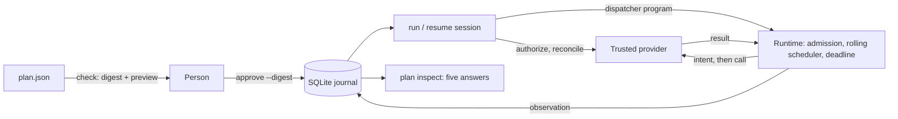

# Recoverable agent actions

**Review a batch of external changes, execute it, and know how to continue after
an interruption.**

An agent or a person writes a plan: a finite list of operations against a
provider, such as "add the `triage` label to issue 104". A person approves its
exact digest. codemode executes it through the same runtime that runs guest
programs, journals each operation before it can reach the provider and after its
result arrives, and, after a crash, asks the provider what happened before doing
anything else. Where nothing can establish the outcome and repeating could
duplicate the effect, it stops and asks a person.



## The workflow

```sh
codemode plan check plan.json --provider provider.json        # digest and preview
codemode plan approve plan.json --journal j.db --provider provider.json \
  --digest sha256:... --approver alice [--concurrency 4 --max-attempts 3 ...]
codemode plan run     --journal j.db --fixture fixture.db --account triage-bot
codemode plan inspect --journal j.db                           # after anything
codemode plan resume  --journal j.db --fixture fixture.db --account triage-bot
codemode plan review  --journal j.db --operation comment-105 --as applied --reviewer alice
codemode plan trace   --journal j.db --session 2 | codemode inspect -
```

`mise run recovery-demo` runs this end to end against the offline fixture:
ten label changes and one comment, four in flight at a time; three responses
lost after their effects, one request held before its effect, the executor
killed with SIGKILL, then inspection, resume, the provider's own ledger, and a
review. The library exposes the same steps: `Plan::parse`, `approval_binding`,
`Journal`, `run_session`, `inspect_journal`, and `Journal::record_review`.

## 1. A finite, immutable plan

A plan (format version 1) is JSON:

```json
{"version": 1, "summary": "Triage ten issues",
 "operations": [{"id": "label-104", "tool": "issues.add_label",
   "scope": {"provider": "fixture.issues", "account": "triage-bot", "destination": "acme/widgets"},
   "arguments": {"issue": 104, "label": "triage"},
   "preconditions": [{"issue_state": "open"}]}]}
```

- Each operation has a stable `id` that survives every attempt, retry, session,
  and trace call identity. Arguments must be a JSON object of at most 64 KiB.
  Preconditions are provider-defined objects the provider checks atomically when
  it applies the operation.
- Unknown fields, unsupported versions, duplicate identities, more than 256
  operations, and argument keys that name credentials (`token`, `password`,
  `api_key`, ...) are refused. The credential check is a guard against obvious
  mistakes, not a secret scanner.
- `Plan::parse` freezes the plan into canonical JSON (keys sorted, no
  whitespace) and its SHA-256 digest. Changing any argument, account,
  destination, or precondition changes the digest.
- There are no dependencies between operations, no variables, and no control
  flow. Operations are offered to the scheduler in plan order. An agent may
  generate the plan with codemode; generating it performs no mutation, and
  nothing about the agent's program is kept or replayed.

## 2. Approval

`plan approve` requires `--digest`, which must repeat the digest that
`plan check` showed, so the approval names what was reviewed. The approval binds
one digest over:

- the plan digest;
- the provider declaration for the plan's tools: provider name, account, and
  each tool's recovery contract;
- the policy: concurrency, attempt and probe budgets, and attempt, probe, and
  session deadlines.

Before every session, the executor recomputes the binding from the journal's
plan, the provider's *current* declaration, and the approved policy. A different
account, a changed contract (for example, a tool that became "safe to repeat"),
or a different plan refuses the session before anything is sent; the refusal
is journaled. A journal holds exactly one plan; a changed plan needs a new
journal and a new approval. Approvals are append-only and the latest applies.

Approval supplements host permissions; it never replaces them. Each session
asks the provider whether every scope is still authorized now (a persisted
approval is not evidence of current authorization), and in the Pi host flow each
operation still passes Pi's own permission gates when dispatched. `--approver`
is a stated name, not an authenticated identity.

## 3. The journal

The journal is a SQLite database (format version 1) holding the frozen plan and
append-only facts, each with an ordinal from one counter: approvals, sessions,
dispatch intents (attempts), observations, reconciliation probes and their
answers, reviews, and
each session's end with its dispatch run's execution record (schema version 2,
readable by `codemode inspect`). Facts are never updated. An attempt key is
`<journal id>-<operation id>-<attempt number>`, where the journal id is generated
per journal, so two journals never share keys; the trace call identity is
recorded with the attempt, so recovery evidence links to the existing trace
without rewriting it.

Ordering per attempt:

1. The intent is committed before the provider can see the attempt. A failed
   intent write stops the run and nothing is sent.
2. The provider is called once, with the attempt key and the operation's
   preconditions, under the attempt deadline.
3. The observation (succeeded, failed with the provider's statement about the
   effect, timed out) is committed before the result is reported to the
   scheduler or to anyone else. A failed observation write stops the run; the
   attempt then stays unknown.
4. When a session's run ends with attempts still waiting (deadline,
   cancellation), the executor first waits for journal writes the run left
   queued, then records each attempt without a result as `unobserved`: still
   unknown.

**Durability.** The journal uses the write-ahead log with exclusive locking.
With the default `--durability storage` (`synchronous=FULL`, and `F_FULLFSYNC`
on macOS), a commit returns after SQLite has asked the operating system to flush
it to stable storage. Whether that survives power loss depends on the device
honoring flushes; no test here establishes it. With `--durability process`
(`synchronous=NORMAL`), commits survive the process being killed but the latest
may be lost on an OS crash or power failure. The tests kill processes with
SIGKILL; they establish process-crash durability only.

**One owner.** Opening a journal takes SQLite's exclusive lock until the process
exits, including after SIGKILL, when the OS releases it. A second executor,
resume, review, or inspection fails at once with "locked by another codemode
process"; inspection therefore waits until a session ends.

**Failing closed.** A file that is not SQLite, not a codemode journal, of
another format version, fails `quick_check`, or whose stored plan does not match
its digest is refused with a diagnostic and left unchanged.

**What is stored.** Plan arguments (needed to retry), error codes, error
messages and probe evidence truncated to 1 KiB, and provider results up to
16 KiB (larger ones keep only their size). Provider credentials stay in the
trusted provider and are never passed to the journal, the guest, or the
dispatcher program, which names operations only.

## 4. Provider-owned recovery contracts

The trusted provider declares, per tool, a `RecoveryContract`; neither the plan
nor guest code can change it:

| `repeat` | `reconcile` | Example (offline fixture) |
| --- | --- | --- |
| `safe`: repeating cannot add a second effect under the provider's documented conditions | `receipt`: the provider looks up receipts for the attempt keys, and **fences** keys it reports as not applied so they can never apply later | `issues.add_label`: set semantics, receipts written with the effect |
| `safe` | `state`: the provider reads authoritative current state; this can show the desired state holds, never who caused it | `issues.remove_label` |
| `unsafe`: repeating can duplicate the effect | `none`: nothing can establish the outcome | `issues.add_comment` |

A provider also states, for every failed attempt, what it knows about the
effect: `refused` (rejected before any effect, such as a failed precondition or
a denied permission), `not_applied` (guaranteed no effect, may be retried), or
`unknown`. A missing response, a timeout, a dropped connection, or a generic
error is `unknown`.

### Conclusions

`assess` folds an operation's facts, in journal order, into one conclusion:

| Conclusion | Meaning | Reached by |
| --- | --- | --- |
| `applied` | Our operation is confirmed applied | an observed result, a receipt, or a review |
| `satisfied` | The desired state holds; attribution is unknown | a state probe |
| `not_applied` | Confirmed not applied; may be sent again | a fenced receipt probe, a `not_applied` error, a withdrawn attempt, or a review |
| `refused` | Rejected before any effect; resending unchanged will not help | a `refused` error |
| `unknown` | An attempt may have reached the provider | an intent without a settling fact |
| `pending` | Never dispatched | no facts |

Each attempt is settled only by its own result, a reconciliation, or a review:
if attempt 1 is unknown and attempt 2 fails a precondition or is not applied, the
operation stays unknown. A `state` probe can only show that the desired state
holds, so its `applied` is read as `satisfied` and its `not_applied` as
`unknown`; only a receipt probe can confirm our effect or its absence.

### What may happen next

| Conclusion | Next step |
| --- | --- |
| `pending` | dispatch |
| `applied`, `satisfied` | done |
| `not_applied` | dispatch while attempts remain, otherwise review |
| `refused` | review |
| `unknown` | reconcile if the contract has a method, probes remain, and it was not probed this session; otherwise dispatch if `repeat` is `safe` and attempts remain; otherwise review |

Budgets (`--max-attempts`, `--max-probes`) count across all sessions, so a crash
loop cannot retry or probe forever: like an attempt's intent, a probe is journaled
before the provider is asked, and an unanswered probe still counts. Every probe and retry is journaled against
the operation's identity, with the session that made it.

Reading current state does not establish causation (`satisfied` is not
`applied`) and does not make a retry safe; only the declared contract does.
codemode never claims exactly-once execution: a `safe` operation may reach the
provider more than once, which the contract says has no further effect, and an
operation the provider cannot reconcile and cannot safely repeat goes to a
person.

## 5. Execution reuses the runtime

A session runs, in order: approval and declaration checks, authorization of
every scope, reconciliation probes (at most `concurrency` at a time, each with
the probe deadline), and one dispatch run. The dispatch run is an ordinary
`codemode::run`: Rust generates a short program that calls
`tools.call(tool, {operation: id})` for each operation to dispatch, and the
existing admission, rolling scheduler, concurrency cap, session deadline,
cancellation, and execution record apply unchanged. A journaling provider
resolves each call to its frozen arguments, refuses anything not approved for
this session or already dispatched in it, and wraps the trusted provider's call
with the intent and observation commits. The program never sees arguments or
results; its replies are `{operation, attempt}` only.

Cancellation (Ctrl-C, SIGTERM) stops new dispatches; attempts already sent stay
unknown. `run` refuses a journal that already has sessions; `resume` reconciles
and continues. Exit status: 0 everything applied or satisfied, 3 work remains
(review or another resume), 4 refused, 124 deadline, 130 cancelled, 2 usage,
journal, or startup errors.

## 6. Inspection

`codemode plan inspect` answers, in this order:

- **What was approved?** Plan digest and summary, tools, scopes, approver,
  binding, provider and account, contracts, and policy.
- **What was attempted and observed?** Sessions (including ones that never
  recorded an end, such as a killed executor), and per operation its attempts,
  probes, and reviews in journal order, with trace call identities.
- **What changed or is currently satisfied?** Operations applied by us, and
  operations satisfied with unknown attribution.
- **What remains uncertain?** Unknown operations.
- **What can safely happen next, and why?** Each remaining operation's next step
  and the reason.

It prints tools, argument keys, error codes, verdicts, and provider evidence, but
not argument values, results, error messages, or review notes unless
`--messages` is given. `--json` returns the same answers as one object.

## Host integration

`codemode plan run|resume --fixture` uses the offline fixture provider in the
Rust process. Other providers implement `RecoverableProvider`. A host such as
Pi runs plan sessions over the bridge protocol (see
[host integration](integrations.md)); a host is then the trusted provider: it
declares the contracts, executes each operation through its own permission
gates, and answers reconciliation probes. Only the host flows listed there have
been verified for plan execution; a CLI-only check does not establish recovery
support for any other adapter.

## Limits

- Process-crash durability is tested; power-loss durability is not.
- Correctness after a crash depends on the provider honoring its contract.
  Receipt reconciliation needs receipts written atomically with the effect and
  fencing of probed keys; without fencing, "not applied" is not decidable.
- No exactly-once claim. A `safe` contract allows repeated requests; the fixture
  ledger shows them as requests without repeated effects.
- `satisfied` says nothing about who caused the state, and a confirmed `applied`
  operation can be undone later by someone else; inspection reports what was
  established, not current state at inspection time.
- Operations are independent; there is no ordering or dependency between them.
- One journal per plan, one executor per journal; inspection waits for a running
  session.
- The approver name is not authenticated; host permissions and provider
  authorization remain the enforcement points.
- The credential-key check catches obvious mistakes only; values are stored as
  given.

Measurements against stop-on-uncertainty and blind-retry baselines are in
[the recovery evaluation](recovery-evaluation.md).
