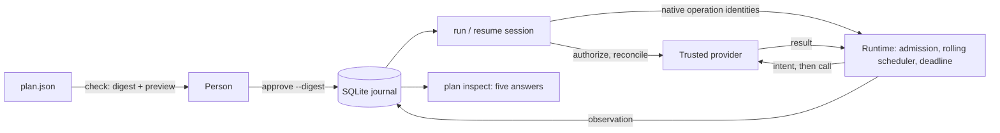

# Recoverable agent actions

**Review a batch of external changes, execute it, and know how to continue after
an interruption.**

An agent or a person writes a plan: a finite list of operations against a
provider, such as "add the `triage` label to issue 104". A person approves its
exact digest. codemode executes it through the same runtime that runs guest
programs, journals each operation before it can reach the provider and after its
result arrives, and, after a crash, asks the provider what happened before doing
anything else. Where nothing can establish the outcome and repeating could
duplicate the effect, it stops and asks a person.

Approved operation identities submit natively to the existing Rust scheduler.
Plans start no worker process. Provider accounts, permissions, retention,
journal ordering, and recovery contracts are unchanged by this dispatch path.
The [GitHub triage guide](composio-github.md) runs this workflow through the
Composio CLI; this document describes the general contract.



## The workflow

```sh
codemode plan check plan.json --provider provider.json        # digest and preview
codemode plan approve plan.json --journal j.db --provider provider.json \
  --digest sha256:... --approver alice [--concurrency 4 --max-attempts 3 ...]
codemode plan run     --journal j.db --bridge                  # a host serves stdio
codemode plan inspect --journal j.db                           # after anything
codemode plan resume  --journal j.db --bridge
codemode plan review  --journal j.db --operation comment-105 --as applied --reviewer alice
codemode plan trace   --journal j.db --session 2 | codemode inspect -
```

`mise run recovery-demo` runs this end to end against the offline fixture, an
issue tracker whose development-only `codemode-fixture session` command hosts the
run and resume sessions: ten label changes and one comment, four in flight at a
time; three responses lost after their effects, one request held before its effect, the executor
killed with SIGKILL, then inspection, resume, the provider's own ledger, and a
review. The library exposes the same steps: `Plan::parse`, `approval_binding`,
`Journal`, `run_session`, `inspect_journal`, and `Journal::record_review`.

## 1. A finite, immutable plan

A plan (format version 1) is JSON:

```json
{"version": 1, "summary": "Triage ten issues",
 "operations": [{"id": "label-104", "tool": "issues.add_label",
   "scope": {"provider": "fixture.issues", "account": "triage-bot", "destination": "acme/widgets"},
   "arguments": {"issue": 104, "label": "triage"},
   "preconditions": [{"issue_state": "open"}]}]}
```

- Each operation has a stable `id` that survives every attempt, retry, session,
  and trace call identity. Arguments must be a JSON object of at most 64 KiB.
  Preconditions are provider-defined objects the provider checks atomically when
  it applies the operation.
- Unknown fields, unsupported versions, duplicate identities, more than 256
  operations, a canonical plan over 1 MiB or nested too deeply to read back,
  integer values outside ±(2^53−1) (a
  JavaScript host such as Pi would round them and act on a value nobody
  approved), and argument keys that name credentials (`token`, `password`,
  `api_key`, ...) are refused. The credential check is a guard against obvious
  mistakes, not a secret scanner.
- `Plan::parse` freezes the plan into canonical JSON (keys sorted, no
  whitespace) and its SHA-256 digest. Changing any argument, account,
  destination, or precondition changes the digest.
- There are no dependencies between operations, no variables, and no control
  flow. Operations are offered to the scheduler in plan order. An agent may
  generate the plan with codemode; generating it performs no mutation, and
  nothing about the agent's program is kept or replayed.

## 2. Approval

`plan approve` requires `--digest`, which must repeat the digest that
`plan check` showed, so the approval names what was reviewed. The approval binds
one digest over:

- the plan digest;
- the provider declaration for the plan's tools: provider name, account, and
  each tool's recovery contract;
- the policy: concurrency and the attempt and probe budgets.

The session deadline (`--deadline-ms` on `run` and `resume`) is not approved:
stopping earlier can only reduce effects, so each session may choose its own.

Before every session, the executor recomputes the binding from the journal's
plan, the provider's *current* declaration, and the approved policy. A different
account, a changed contract (for example, a tool that became "safe to repeat"),
or a different retention policy, or a different plan refuses the session before
anything is sent; the refusal is journaled. A journal holds exactly one plan; a changed plan needs a new
journal and a new approval. Approvals are append-only and the latest applies.

Approval supplements host permissions; it never replaces them. Each session
asks the provider whether every scope is still authorized now (a persisted
approval is not evidence of current authorization), and in the Pi host flow each
operation still passes Pi's own permission gates when dispatched. `--approver`
is a stated name, not an authenticated identity.

## 3. The journal

The journal is a SQLite database (format version 2) holding the frozen plan and
append-only facts, each with an ordinal from one counter: approvals, sessions,
dispatch intents (attempts), observations, reconciliation probes and their
answers, reviews, and
each session's end with its native dispatch run's execution record (report
schema version 5, readable by `codemode inspect`). Facts are never updated. An attempt key is
`<journal id>-<operation id>-<attempt number>`, where the journal id is generated
per journal, so two journals never share keys; the trace call identity is
recorded with the attempt, so recovery evidence links to the existing trace
without rewriting it.

Ordering per attempt:

1. The intent is committed before the provider can see the attempt. A failed
   intent write stops the run and nothing is sent. The executor's unit tests
   prove this order on the journaling path itself: a test-only hook holds the
   intent's transaction open, and the provider is not entered until it commits;
   a failed commit, or cancellation or a deadline while the commit is held,
   never reaches the provider. A mutation that dispatches concurrently with the
   intent write fails those tests. The SIGKILL tests complement them: every
   request the fixture received has a journaled intent.
2. The provider is called once, with the attempt key and the operation's
   preconditions, under the session deadline.
3. The observation (succeeded, or failed with the provider's statement about
   the effect) is committed before the result is reported to the
   scheduler or to anyone else. A failed observation write stops the run; the
   attempt then stays unknown.
4. When a session's run ends with attempts still waiting (deadline,
   cancellation), the executor first waits for journal writes the run left
   queued, then records each attempt without a result as `unobserved`: still
   unknown.

Group commit keeps this order. Intents, observations, and probe records that
wait while another commit is in flight share the next transaction. Each
attempt or probe continues only after the commit that holds its own record. A
failed group commit fails every record in it, so none of its attempts is
dispatched or recorded. The unit tests hold and fail grouped commits to prove
this ([measurements](recovery-evaluation.md#group-commit)).

**Durability.** The journal uses SQLite's write-ahead log in normal locking mode.
With `synchronous=FULL` (and `F_FULLFSYNC` on macOS), a commit returns after
SQLite has asked the operating system to flush it to stable storage. Whether
that survives power loss depends on the device honoring flushes; no test here
establishes it. The tests kill processes with SIGKILL; they establish
process-crash durability only.

**One owner.** Every command that writes the journal (`approve`, `run`,
`resume`, `review`) first takes an exclusive operating-system lock on the lock
file `<journal>.lock` beside it, and holds it until the process exits, including
after SIGKILL, when the OS releases it. A second executor fails at once with
"locked by another codemode executor" and changes nothing. The lock file is part
of the journal: copy, move, or delete it only together with the journal files
(`<journal>`, `<journal>-wal`, `<journal>-shm`) and never while a command runs.
Deleting or replacing it while an executor holds it lets a second executor in;
that is tampering outside the exclusion guarantee. An executor that finds its
lock file replaced while it was taking the lock refuses to start.

**Concurrent inspection.** `plan inspect` and `plan trace` open the journal
read-only, never touch the lock file, and work while a session runs. They read
one consistent snapshot of committed facts, write no journal data, change no
durability setting, and never checkpoint the write-ahead log. SQLite may create
its shared-memory index (`<journal>-shm`) and an empty `<journal>-wal` beside the
journal, so inspection needs a writable directory unless those files exist; if
SQLite cannot read the journal without writing, inspection fails with "could not
be opened read-only" rather than opening it for writing. A session without a
recorded end is shown as `open — no end recorded; this does not show that an
executor is running`: the executor may be running, or may have been killed.

**Failing closed.** A file that is not SQLite, not a codemode journal, of
another format version, fails `quick_check`, or whose stored plan does not match
its digest is refused with a diagnostic and left unchanged: these checks run under
the executor lock, in a write transaction, before anything is written.

**What is stored.** The journal keeps the approved plan for its whole
lifetime, because recovery needs it to retry and to probe: every argument value
(for the Composio host, full comment bodies, issue numbers, and labels), each
operation's scope (account and destination), and its preconditions. It also
keeps the approver's and reviewers' stated names and notes, each cut to 1 KiB.
These approved inputs are the only sensitive values the journal must keep; they
do not expire. Deleting the journal files (`<journal>`, `-wal`, `-shm`, and
`.lock`) removes them; do that only when no command is using the journal.

From the provider, the journal keeps only what its approved **retention
policy** keeps. The provider declares the
policy (`"retention"` in its declaration); the approval binds it, so a plan,
guest code, or a result field cannot select or widen it, and a changed policy
refuses the session until it is approved again.

| Kept | `metadata/1` (default) | `summary/1` |
| --- | --- | --- |
| Attempt keys, order, outcome, stated effect, result size, probe verdicts | yes | yes |
| Error codes (1 to 64 of `A-Z a-z 0-9 _ . : -`; anything else becomes `unrecognized_code`) | yes | yes |
| Error messages and probe evidence | no | truncated to 1 KiB |
| Result values | no | no |

The journal applies the policy inside each write, before SQLite sees the data,
so excluded text never reaches the database file or its write-ahead log. This
covers observations, probe answers and failures, and the dispatch run's trace,
whose provider errors carry only the machine code. Session details are written
by codemode itself; an authorization refusal names the scope and the code only.
`summary/1` is for providers that write their own short explanations, such as
the offline fixture ("receipt for attempt 2 found"): the provider promises they
are projections, not upstream text, and codemode does not check them. Neither
policy makes plan arguments or other private data secret-free.

`plan inspect` never prints argument values, and prints notes and error
messages only with `--messages`. `plan check` prints arguments in full, because
the reviewer must see what approval binds.

Recovery decisions use only the facts every policy keeps, so the same history
reaches the same conclusions under either policy (tested through the bridge).

*Older journals.* A journal of any other format version, including one whose
approvals predate retention policies, is refused at open as described above;
there is no migration. Keep such a file with the binary that wrote it.

Provider credentials stay in the trusted provider and are never passed to the
journal or any guest. Native dispatch requests name operation identities only;
the trusted journaling provider reads their approved arguments.

## 4. Provider-owned recovery contracts

The trusted provider declares, per tool, a `RecoveryContract`; neither the plan
nor guest code can change it:

| `repeat` | `reconcile` | Example (offline fixture) |
| --- | --- | --- |
| `safe`: repeating cannot add a second effect under the provider's documented conditions | `receipt`: the provider looks up receipts for the attempt keys, and **fences** keys it reports as not applied so they can never apply later | `issues.add_label`: set semantics, receipts written with the effect |
| `safe` | `state`: the provider reads authoritative current state; this can show the desired state holds, never who caused it | `issues.remove_label` |
| `unsafe`: repeating can duplicate the effect | `none`: nothing can establish the outcome | `issues.add_comment` |

A provider also states, for every failed attempt, what it knows about the
effect: `refused` (rejected before any effect, such as a failed precondition or
a denied permission), `not_applied` (guaranteed no effect, may be retried), or
`unknown`. A missing response, a timeout, a dropped connection, or a generic
error is `unknown`.

### Conclusions

`assess` folds an operation's facts, in journal order, into one conclusion:

| Conclusion | Meaning | Reached by |
| --- | --- | --- |
| `applied` | Our operation is confirmed applied | an observed result, a receipt, or a review |
| `satisfied` | The desired state holds; attribution is unknown | a state probe |
| `not_applied` | Confirmed not applied; may be sent again | a fenced receipt probe, a `not_applied` error, a withdrawn attempt, or a review |
| `refused` | Rejected before any effect; resending unchanged will not help | a `refused` error |
| `unknown` | An attempt may have reached the provider | an intent without a settling fact |
| `pending` | Never dispatched | no facts |

Each attempt is settled only by its own result, a reconciliation, or a review:
if attempt 1 is unknown and attempt 2 fails a precondition or is not applied, the
operation stays unknown. A `state` probe can only show that the desired state
holds, so its `applied` is read as `satisfied` and its `not_applied` as
`unknown`; only a receipt probe can confirm our effect or its absence.

### What may happen next

| Conclusion | Next step |
| --- | --- |
| `pending` | dispatch |
| `applied`, `satisfied` | done |
| `not_applied` | dispatch while attempts remain, otherwise review |
| `refused` | review |
| `unknown` | reconcile if the contract has a method, probes remain, and it was not probed this session; otherwise dispatch if `repeat` is `safe` and attempts remain; otherwise review |

Budgets (`--max-attempts`, `--max-probes`) count across all sessions, so a crash
loop cannot retry or probe forever: like an attempt's intent, a probe is journaled
before the provider is asked, and an unanswered probe still counts. Every probe and retry is journaled against
the operation's identity, with the session that made it.

Reading current state does not establish causation (`satisfied` is not
`applied`) and does not make a retry safe; only the declared contract does.
codemode never claims exactly-once execution: a `safe` operation may reach the
provider more than once, which the contract says has no further effect, and an
operation the provider cannot reconcile and cannot safely repeat goes to a
person.

## 5. Execution reuses the runtime

A session runs, in order: approval and declaration checks, authorization of
every scope, reconciliation probes (at most `concurrency` at a time), and one
dispatch run. One deadline, `--deadline-ms` (default 300000), bounds all of it
from the session's start, including host permission waits inside a provider
call. An authorization without an answer by then ends the session
`interrupted` before anything is probed or dispatched. A probe without an
answer is recorded as `probe_timeout` and still counts against `--max-probes`.
Reached before an attempt's intent commits, the deadline withdraws the attempt;
after, the call is dropped and the attempt stays unknown (`unobserved`).
`codemode::run_calls` submits each tool and `{operation: id}` directly, and the
existing admission, rolling scheduler, concurrency cap, the time left before
the session deadline, cancellation, and execution record apply unchanged. A
journaling provider resolves each call to its frozen arguments, refuses
anything not approved for this session or already dispatched in it, and wraps
the trusted provider's call with the intent and observation commits. Scheduler requests name operation
identities only; the wrapper returns small `{operation, attempt}` receipts.
No program is generated or guest process started.

Cancellation (Ctrl-C, SIGTERM) interrupts authorization and reconciliation as
well as dispatch, even when a yielding provider ignores the signal. Rust stops
new scope checks, probes, and dispatches, then aborts and joins active probe
tasks before returning an `interrupted` session. Recorded probe starts stay
unanswered and count against the approved budget across resumes. Dropping a read
future does not prove that its remote request never happened; it supplies no
new evidence about an uncertain operation. Attempts already sent stay unknown
unless an observation has settled them. `run` refuses a journal that already has
sessions; `resume` reconciles and continues. Exit status: 0 everything applied or satisfied, 3 work remains
(review or another resume), 4 refused, 124 deadline (in any phase), 130
cancelled, 1 the dispatch run stopped for another reason, 2 usage, journal, or
startup errors.

## 6. Inspection

`codemode plan inspect` answers, in this order:

- **What was approved?** Plan digest and summary, tools, scopes, approver,
  binding, provider and account, contracts, and policy.
- **What was attempted and observed?** The latest 20 sessions, with a count of
  earlier ones (including open sessions, which recorded no end: a running or a
  killed executor), and per operation its attempts, probes, and reviews in
  journal order, with trace call identities.
- **What changed or is currently satisfied?** Operations the provider
  confirmed it executed for us, and operations satisfied with unknown
  attribution. `applied` means the provider executed our operation; under set
  semantics it may have found the state already as requested, which the
  provider's result (and, for the fixture, its ledger) shows.
- **What remains uncertain?** Unknown operations.
- **What can safely happen next, and why?** Each remaining operation's next step
  and the reason.

It prints tools, argument keys, error codes, verdicts, the retention policy, and
probe evidence the policy kept, but not argument values, error messages, or
approval and review notes unless `--messages` is given. `--messages` cannot show
what the journal never kept. `--json` returns the same answers as one object;
it is the diagnosis to share: it holds no argument or result values, and the
journal keeps approver names, notes, and other stored text to 1 KiB each.

## Host integration

The CLI runs plan sessions only through a host over the plan bridge
(`--bridge`); library users can implement `RecoverableProvider` instead. The
offline fixture provider behind the demo and tests is development-only and is
not installed. A host such as Pi runs plan sessions over the bridge protocol (see
[host integration](integrations.md)); a host is then the trusted provider: it
declares the contracts, executes each operation through its own permission
gates, and answers reconciliation probes. The Composio GitHub host (labels,
issue state, and marked comments) is checked offline through the bridge; see
[its guide](composio-github.md) for what ran live. Only the host flows listed there have
been verified for plan execution; a CLI-only check does not establish recovery
support for any other adapter.

## Limits

- Process-crash durability is tested; power-loss durability is not.
- Correctness after a crash depends on the provider honoring its contract.
  Receipt reconciliation needs receipts written atomically with the effect and
  fencing of probed keys; without fencing, "not applied" is not decidable.
- No exactly-once claim. A `safe` contract allows repeated requests; the fixture
  ledger shows them as requests without repeated effects.
- `satisfied` says nothing about who caused the state, and a confirmed `applied`
  operation can be undone later by someone else; inspection reports what was
  established, not current state at inspection time.
- Operations are independent; there is no ordering or dependency between them.
- One journal per plan, one executor per journal; inspection reads committed
  facts while a session runs and cannot tell a running executor from a killed one.
- The approver name is not authenticated; host permissions and provider
  authorization remain the enforcement points.
- The credential-key check catches obvious mistakes only; values are stored as
  given.

## Measured tradeoffs

The first measurements below predate group commit and are kept as history.

[The final native recovery evaluation](../eval/recovery-native-final/summary.md) recovers one identical crashed
state (the demonstration's) three ways on one Apple M1 Pro, 15 runs each. Resume
reached the intended state in every run with no duplicate effect and left the
comment for review; blind retry duplicated the comment in every run while
claiming success; stopping on uncertainty left five operations unresolved.
Resume is the slowest: 89.2 ms at p50 against 17.0 ms for blind retry, without
provider latency. Native execution has no guest startup; durable commits
dominate. Each flushed commit costs about 6 ms here (`F_FULLFSYNC`), so the
journal, not the provider, limits a large batch; a since-removed `process`
durability mode, measured in the same evaluation, added under 1 ms per operation.
[Group commit](recovery-evaluation.md#group-commit), measured later, cut the
median journal cost of a 64-operation batch at zero provider latency by about
30% by sharing transactions between overlapping calls. The
[evaluation document](recovery-evaluation.md) keeps earlier results from a
since-removed engine separate.
